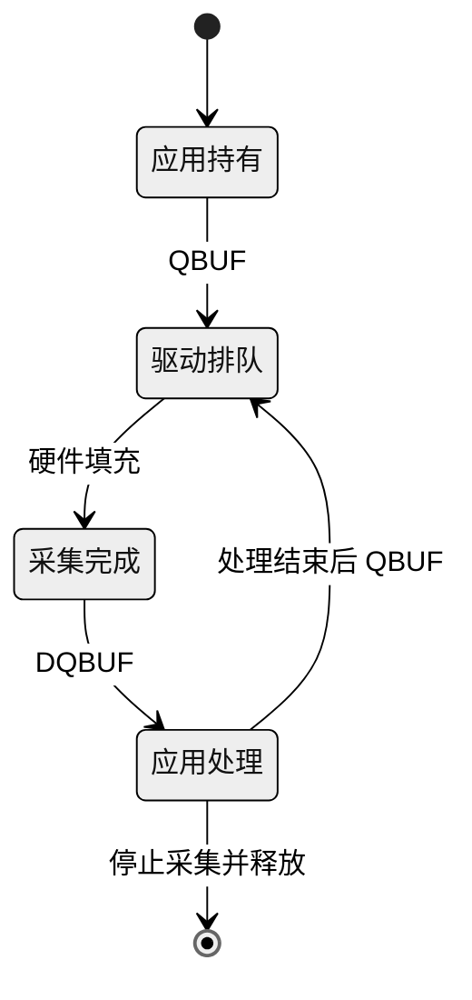

# 连续采集、超时与资源释放

第一帧只能证明通路可用。连续采集要回答另外几个问题：缓冲区能不能一直循环、实际帧率是多少、序号有没有断、出错或按 Ctrl-C 时能不能干净退出。这一课把取帧放进循环里，先不保存、不编码，只看采集这一段的连续性。

## 缓冲区的循环

采集第一帧后，如果不把 buffer 重新交回驱动，可用缓冲区最终会耗尽。连续采集的核心不是反复重新打开设备，而是**反复转移缓冲区的使用权**。



图 1：缓冲区状态。

应用不能保留映射指针给异步消费者后，立即 QBUF 让硬件覆盖它。

## 循环取帧

初始化流程和上一课相同：设置输入、格式、帧率，申请缓冲区、映射、全部 QBUF，然后 `STREAMON`。区别在启动之后：

```c
while (received < target && !g_stop) {
	struct pollfd p = {.fd = fd, .events = POLLIN};
	int ready;
	do {
		ready = poll(&p, 1, TIMEOUT_MS);
	} while (ready < 0 && errno == EINTR && !g_stop);

	if (g_stop)
		break;
	if (!ready) {
		fprintf(stderr, "等待 %d ms 没有收到帧\n", TIMEOUT_MS);
		goto out;
	}

	/* DQBUF ... */

	if (xioctl(fd, VIDIOC_QBUF, &buf) < 0) {
		perror("VIDIOC_QBUF return");
		goto out;
	}
	received++;
}
```

`poll` 返回可读后 `DQBUF` 取帧，处理完立刻 `QBUF` 还给驱动。设备是非阻塞打开的，`DQBUF` 遇到 `EAGAIN` 表示这一轮没有可取 buffer，继续等下一次；`EINTR` 是信号打断，重试即可。其他错误不能忽略，走到统一的清理出口。

这一课拿到帧后只做统计，不写文件、不编码。加入磁盘写入或编码后，帧率会受它们影响，测量口径要跟着变。

## 序号与帧率

帧率用单调时钟统计，不用墙上时间：

```c
double start = now_ms();
/* ... */
double seconds = (now_ms() - start) / 1000.0;
printf("frames=%ld elapsed=%.3fs fps=%.2f gaps=%ld errors=%ld\n",
       received, seconds, seconds > 0 ? received / seconds : 0.0,
       gaps, errors);
```

统计窗口从启动采集开始，到最后一次成功出队结束。程序配置的 60 fps 是请求值，不是成绩；本板实测 59.87，差值来自时钟和调度。

判断有没有丢帧看 `sequence` 的差值，不看到达次数：

```c
uint32_t sequence = buf.sequence;
if (have_last && sequence != last_sequence + 1)
	gaps += sequence - last_sequence - 1;
last_sequence = sequence;
have_last = 1;
```

**`QBUF` 之后驱动会清空 `v4l2_buffer` 的字段**，序号要在还缓冲区之前取出来。写这一课时先用了 `buf.sequence` 打印，结果每行都是 0，改成本地变量后才显示真实序号。

另外，`sequence` 不一定从 0 开始。它跟随输入锁定后的帧计数，停一次服务再启动，起点会往后跳；判断连续性只看相邻两帧的差值。

## 超时与中断

`poll` 的 2 秒超时用来发现“设备还在，但没有帧”：输入掉锁、源设备休眠或线缆松动都会表现成这个错误，程序直接退出，不假装采集正常。

按 Ctrl-C 时，信号处理函数只置一个标志：

```c
static volatile sig_atomic_t g_stop;

static void on_signal(int sig)
{
	(void)sig;
	g_stop = 1;
}
```

循环每轮检查 `g_stop`，`poll` 被信号打断返回 `EINTR` 时也会走到这里。处理函数里不做打印、不开锁、不释放资源，退出循环后再统一清理并打印摘要。

## 释放顺序

正常结束、超时、信号中断都走同一个出口：

```c
out:
	if (streaming && xioctl(fd, VIDIOC_STREAMOFF, &type) < 0)
		perror("VIDIOC_STREAMOFF");
	for (uint32_t i = 0; i < BUFFER_COUNT; i++) {
		if (buffers[i].start)
			munmap(buffers[i].start, buffers[i].length);
	}
	if (req.count) {
		req.count = 0;
		xioctl(fd, VIDIOC_REQBUFS, &req);
	}
	close(fd);
```

先停流，再解除映射，最后释放驱动侧缓冲区并关闭设备。顺序反了，驱动可能还在往已解除映射的内存写数据。

## 编译与运行

把上面的循环补全成一个完整程序，就是 [14-capture-loop](/examples/kvm/03-capture/14-capture-loop/capture_loop.c)；课件里的版本可以对照。

### 编译

```bash
make SDK_ROOT=~/T527_Tina5.0_SDK
file capture_loop
"${CROSS_COMPILE}readelf" -h capture_loop | grep Machine
```

应显示 `ELF 64-bit` 和 `ARM aarch64`；板端没有编译器，程序在开发主机编好后传上去。

### 传到板子

在开发主机进入课件目录起临时 HTTP 服务：

```bash
cd <课件目录>
python3 -m http.server 8000
```

板端下载并和主机 `md5sum` 对照：

```sh
wget -q -O /tmp/capture_loop http://192.168.1.69:8000/capture_loop
chmod +x /tmp/capture_loop
md5sum /tmp/capture_loop
```

### 板端运行

先停 KVM，再运行；程序会自己等输入锁定：

```sh
/etc/init.d/S99kvm stop
./capture_loop /dev/video0 300
/etc/init.d/S99kvm start
```

300 帧在 60 fps 下约 5 秒。也可以按 Ctrl-C 提前结束，程序会打印已收到的帧数和帧率。

## 板端输出

```text
waiting for HDMI input...
input locked: 1920x1080@60
buffers=4 sizeimage=3133440 bytesperline=2880
frame=60 sequence=61 fps=59.3
frame=120 sequence=121 fps=59.7
frame=180 sequence=181 fps=59.8
frame=240 sequence=241 fps=59.8
frame=300 sequence=301 fps=59.9
frames=300 elapsed=5.011s fps=59.87 gaps=0 errors=0
```

`sequence` 从 61 开始，是因为这次启动前输入已经锁定了约一秒；相邻两帧始终差 1，`gaps=0` 才说明没有断帧。

## 验收

- 请求 300 帧，实际收到 300 帧，`errors=0`；
- `fps` 在 59–60 之间，`gaps=0`；
- 程序退出后没有残留进程，`/dev/video0` 能再次打开；
- 按 Ctrl-C 也能打印摘要并干净退出，`/etc/init.d/S99kvm start` 后四个服务正常。

## 常见问题

| 现象 | 原因 | 处理 |
| --- | --- | --- |
| `Device or resource busy` | 还有进程占用采集设备 | 停 KVM，确认 `pidof kvm_video` 为空 |
| `等待 2000 ms 没有收到帧` | 输入在采集过程中掉锁 | 看 `dmesg`，检查 HDMI 源和线缆 |
| `gaps` 不为 0 | 驱动丢帧或输入重新锁定 | 结合 `dmesg` 和 `sequence` 差值判断 |
| 帧率明显低于 60 | 源不是 60 Hz，或程序里加入了耗时处理 | 先确认输入模式，再对比不同处理的耗时 |

采集这一段确认后，下一阶段把 NV12 缓冲区交给硬件编码器，生成 H.264 码流。
