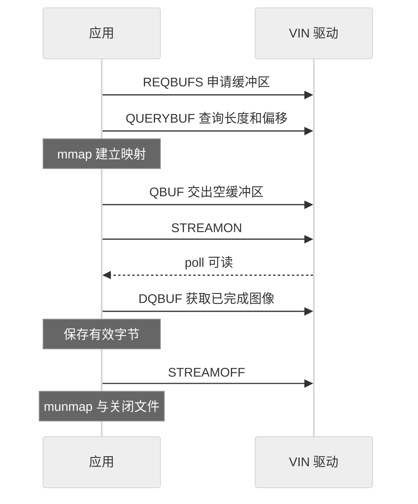
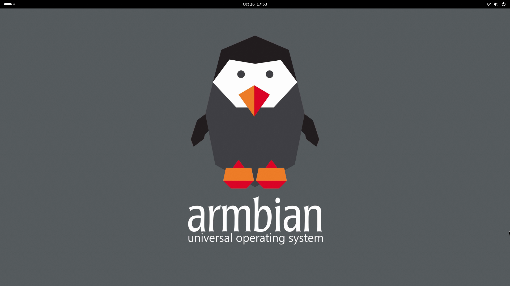

# 用 MMAP 获取并保存第一帧

上一课只问到了参数，还没有拿到一帧数据。要得到图像，需要把缓冲区交给驱动，等采集完成，再把数据取回来。这一课写完这条流程，把第一帧 NV12 存成文件，并用 FFmpeg 确认画面正常。

## MMAP 与缓冲区所有权

MMAP 将驱动分配的图像内存映射到进程地址空间，应用访问映射地址就能读取数据。**`QBUF` 后该 buffer 交给驱动**，应用不能同时修改它；**`DQBUF` 后应用才能处理本次图像**。接口定义参见 [V4L2 MMAP](https://docs.kernel.org/userspace-api/media/v4l/mmap.html)。



图 1：第一帧的取得过程。

这里的箭头是控制调用，图像由硬件写入缓冲区。

## 申请缓冲区

查询完格式，先申请一组 MMAP 缓冲区：

```c
req.type = type;
req.memory = V4L2_MEMORY_MMAP;
req.count = BUFFER_COUNT;
if (xioctl(fd, VIDIOC_REQBUFS, &req) < 0) {
	perror("VIDIOC_REQBUFS");
	goto out;
}
```

`req.count` 是希望的个数，驱动可以少给；返回后要检查 `req.count`，少于两个就无法在采集一帧的同时保留备用缓冲区。

**这块 VIN 驱动在 `REQBUFS` 里才计算行跨度和缓冲区容量**，不是 `S_FMT`。所以申请之后要再读一次格式，不能沿用之前的零值：

```c
memset(&fmt, 0, sizeof(fmt));
fmt.type = type;
if (xioctl(fd, VIDIOC_G_FMT, &fmt) < 0) {
	perror("VIDIOC_G_FMT after REQBUFS");
	goto out;
}
printf("buffers=%u sizeimage=%u bytesperline=%u\n", req.count,
       fmt.fmt.pix_mp.plane_fmt[0].sizeimage,
       fmt.fmt.pix_mp.plane_fmt[0].bytesperline);
```

本板打印 `buffers=4 sizeimage=3133440 bytesperline=2880`。

## 映射与交还

每个缓冲区都要单独 `QUERYBUF`，拿到自己的长度和偏移：

```c
buffers[i].length = plane.length;
buffers[i].start = mmap(NULL, plane.length, PROT_READ | PROT_WRITE,
                        MAP_SHARED, fd, plane.m.mem_offset);
if (buffers[i].start == MAP_FAILED) {
	buffers[i].start = NULL;
	perror("mmap");
	goto out;
}
if (xioctl(fd, VIDIOC_QBUF, &buf) < 0) {
	perror("VIDIOC_QBUF");
	goto out;
}
```

`buf.length = 1` 表示传入一个 plane 描述，不是一字节图像；真正的映射长度是 `plane.length`。不能把第一个缓冲区的偏移套给所有映射，也不能用第 12 章算出的紧密容量代替它。

映射完成后立刻 `QBUF`，把空缓冲区交还驱动。此时应用不能再写这块内存，直到 `DQBUF` 把它还回来。

## 启动采集

所有缓冲区都交还之后，启动流式采集：

```c
if (xioctl(fd, VIDIOC_STREAMON, &type) < 0) {
	perror("VIDIOC_STREAMON");
	goto out;
}
```

然后用 `poll` 等待驱动通知有帧可读，超时设为 2 秒：

```c
struct pollfd p = {.fd = fd, .events = POLLIN};
int ready;
do {
	ready = poll(&p, 1, TIMEOUT_MS);
} while (ready < 0 && errno == EINTR);
if (!ready) {
	fprintf(stderr, "等待 %d ms 没有收到帧\n", TIMEOUT_MS);
	goto out;
}
```

`poll` 返回可读后再 `DQBUF`。这一步拿到的 `index` 指向本次完成的缓冲区，`sequence` 是驱动给的帧序号。取回后先校验索引、长度和错误标志，再碰数据：

```c
if (buf.index >= req.count ||
    plane.data_offset > plane.bytesused ||
    plane.bytesused > buffers[buf.index].length ||
    (buf.flags & V4L2_BUF_FLAG_ERROR)) {
	fprintf(stderr, "收到无效帧\n");
	goto out;
}
```

## 保存有效字节

有效数据从 `data_offset` 开始，长度是 `bytesused - data_offset`，不是整个映射长度。输出文件用排他创建，避免覆盖上一次实验：

```c
size_t size = plane.bytesused - plane.data_offset;
out = open(out_path, O_WRONLY | O_CREAT | O_EXCL, 0644);
if (out < 0) {
	perror("open output");
	goto out;
}
if (write_all(out, (char *)buffers[buf.index].start + plane.data_offset,
	      size) < 0) {
	perror("write output");
	goto out;
}
```

本板 `bytesused=3133440`、`data_offset=0`，所以文件是 3,133,440 字节。

## 停止与释放

保存完把缓冲区还回去，再按申请的逆序清理：

```c
xioctl(fd, VIDIOC_QBUF, &buf);
xioctl(fd, VIDIOC_STREAMOFF, &type);
for (uint32_t i = 0; i < BUFFER_COUNT; i++) {
	if (buffers[i].start)
		munmap(buffers[i].start, buffers[i].length);
}
req.count = 0;
xioctl(fd, VIDIOC_REQBUFS, &req);
close(fd);
```

`STREAMOFF` 要在 `munmap` 之前，否则驱动可能还在往已解除映射的内存写数据。`REQBUFS` 把 `count` 置 0 是释放驱动侧缓冲区，最后关闭文件描述符。

## 编译与运行

把前面几段拼起来就是 [13-first-frame](/examples/kvm/03-capture/13-first-frame/first_frame.c)，课件里的完整版本可以对照。

### 编译

```bash
make SDK_ROOT=~/T527_Tina5.0_SDK
file first_frame
"${CROSS_COMPILE}readelf" -h first_frame | grep Machine
```

应显示 `ELF 64-bit` 和 `ARM aarch64`；板端没有编译器，程序在开发主机编好后传上去。

### 传到板子

在开发主机进入课件目录起临时 HTTP 服务：

```bash
cd <课件目录>
python3 -m http.server 8000
```

板端下载并和主机 `md5sum` 对照：

```sh
wget -q -O /tmp/first_frame http://192.168.1.69:8000/first_frame
chmod +x /tmp/first_frame
md5sum /tmp/first_frame
```

### 板端运行

`/dev/video0` 同一时间只能有一个采集者。先停 KVM，再运行；程序会自己等输入重新锁定：

```sh
/etc/init.d/S99kvm stop
./first_frame /dev/video0 /tmp/first-frame.nv12
/etc/init.d/S99kvm start
```

停掉视频服务会让采集模块短暂掉锁，日志里先出现 `HDMI input unavailable`，几百毫秒后才重新 `locked`。程序在启动采集前用 `VIDIOC_QUERY_DV_TIMINGS` 连续确认三次 1080p60，最多等 10 秒，避免在锁定过程中 `STREAMON`。早期版本没有这个等待，实测报过 `s_stream on=1 result=-67`，然后一直收不到帧。

## 板端输出

```text
waiting for HDMI input...
input locked: 1920x1080@60
buffers=4 sizeimage=3133440 bytesperline=2880
sequence=2 bytesused=3133440 offset=0 saved=3133440 elapsed=82.8ms
```

82.8 ms 里包含等待输入、申请缓冲区、启动采集、等待第一帧和写文件，不是单帧采集周期。后面的连续采集会单独测帧率。

## 检查图像

把文件传回主机，用 FFmpeg 按紧密 NV12 解码：

```bash
ffmpeg -f rawvideo -pixel_format nv12 -video_size 1920x1080 \
  -i first-frame.nv12 -frames:v 1 first-frame.png
```

本板取到的帧：



图 2：`first_frame` 保存的帧经 FFmpeg 解码。画面正常、颜色正确，说明缓冲区开头就是紧密 NV12。

文件比紧密容量多出的 23,040 字节是尾部填充。本板实测这段与全零块 MD5 相同，FFmpeg 只读前 3,110,400 字节，不受影响。

## 验收

- 程序退出码为 0，打印 `sequence`、`bytesused`、`saved`；
- 文件不小于 3,110,400 字节，前 3,110,400 字节能按 1920×1080 NV12 正常解码；
- 尾部填充不影响播放；若多出的部分有非零数据，说明布局判断有误；
- `/etc/init.d/S99kvm start` 后四个服务都能重新拉起。

## 常见问题

| 现象 | 原因 | 处理 |
| --- | --- | --- |
| `Device or resource busy` | 还有进程占用采集设备 | 停 KVM，确认 `pidof kvm_video` 为空 |
| `等待 2000 ms 没有收到帧` | 输入在启动后又掉锁，或源设备没有持续输出 | 看 `dmesg` 是否反复 `unavailable`，检查 HDMI 源 |
| `s_stream on=1 result=-67` | 启动瞬间输入未锁定 | 程序已等待三次确认；仍出现时检查源设备和线缆 |
| 文件大小是 3,110,400 而不是 3,133,440 | `bytesused` 不含尾部填充 | 两种都能解码，记录实际值 |
| 图像错色或错行 | 像素格式或布局判断错误 | 回看第 12 章的 `G_FMT` 输出 |

下一课让同一组缓冲区循环起来：连续取帧、统计帧率，并处理超时和退出时的资源释放。
