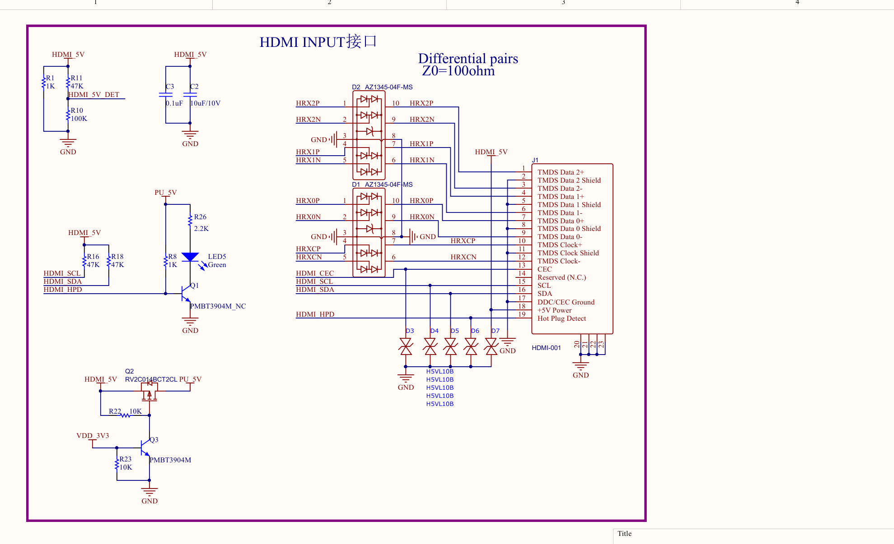

# 核对 HDMI 输入是否正常

SDK 的驱动和设备树已经在上一课核对过。这一课沿“源设备输出 → 模块供电/HPD → 输入锁定 → VIN 节点 → 实际画面”检查现有配置，确认 HDMI 输入真的可用；正常流程不改驱动或设备树。

## 从源设备确认输出

在源设备显示设置里确认已启用 1920×1080 输出。若源设备同时有 HDMI IN 和 HDMI OUT，**模块必须接到输出口**。Linux DRM 源设备可先只读查看：

```sh
for d in /sys/class/drm/card*-HDMI-A-*; do
    [ -d "$d" ] || continue
    echo "$d"
    cat "$d/status"
    cat "$d/modes"
done
```

这些命令运行在**被控源设备**，不是 KVM 主板。`connected` 只能证明连接检测，不能单独证明正在传送 1080p 帧；还要结合桌面设置、当前模式和 KVM 采集结果。

## 模块电源与 HPD 电路

图中重点看 HDMI_5V 到 PU_5V 的 Q2，以及 VDD_3V3 控制的 Q3。它们不是同一种器件。



图 1：HDMI 输入与 HPD 电路。

该板的 Q2 型号为 RV2C014BCT2CL，Q3 为 PMBT3904M。已有调试中出现过两者装反：上游部分节点约 4.7V，但 HPD 相关上拉两端仅约 1V，修正装配后恢复。这个案例说明应沿电源与信号网络逐点定位，不能看到两个模块晶振不同就先修改驱动时钟。

**模块本地晶振与 T527 输出的 MCLK 是不同对象**。配套模块图纸标为 24MHz，J2 的 CSI_MCLK 标注保留未用；是否匹配固件应检查对应版本资料。正常核对时只确认模块供电路径和 HPD 状态，不修改这些电路。

## 检查板端输入状态

先确认驱动和节点仍然存在（上一课已逐项核对）：

```sh
lsmod | grep -E 'lt6911|vin'
cat /sys/module/lt6911c_mipi/parameters/refclk_hz
ls -l /dev/video0
cat /sys/class/video4linux/video0/name
```

本次样机的 `refclk_hz` 为 `24000000`，`/dev/video0` 名称为 `vin_video0`。然后看驱动日志：

```sh
dmesg | grep -Ei 'lt6911|sensor_detect|HDMI input' | tail -20
```

本次运行中能看到输入反复检测的过程：

```text
sunxi:vin:[INFO]: [lt6911c_mipi]HDMI input locked: 1920x1080@60 error=0
sunxi:vin:[INFO]: [lt6911c_mipi]HDMI input unavailable: 1748x0@71 error=-67
sunxi:vin:[INFO]: [lt6911c_mipi]HDMI input locked: 1920x1080@60 error=0
```

`locked: 1920x1080@60` 表示模块已经识别到有效时序；`unavailable` 可能出现在源切换或重新检测的瞬间。**不要用一条 `unavailable` 判定失败**，应以持续出现的 `locked`、设备节点和实际画面为准。本课不依赖单独的时序查询 ioctl，避免把驱动内部检测状态当成唯一证据。

## 用现有系统确认画面

如果镜像已经带生产 KVM 服务，打开板端网页：

```text
http://<板端 IP>/
```

本次样机可以看到 HDMI 源的桌面。网页菜单和 HTTP 资源只证明 Go 服务正常，**只有视频区域出现画面才证明 HDMI 输入、VIN、编码和 WebRTC 这条链路走通**。如果画面停在“等待第一帧”，回到驱动日志和 `/dev/video0` 检查，不要先改应用。

如果使用的是纯基础镜像，不启动生产 KVM，也可以在后续章节用自己的 V4L2 程序查询格式和取第一帧；本课先把源、HPD、模块和 VIN 状态确认清楚。

## HPD 异常时的诊断边界

如果只有强制源设备输出才能采集，说明正常接入时的 HPD/EDID 路径仍有问题。强制输出是诊断条件，不能替代正常接入验收。此时沿以下顺序检查：

| 检查点 | 含义 |
| --- | --- |
| 源设备 `connected` 和 1080p 模式 | 源端是否认为显示设备存在 |
| 模块 3.3V 供电和 HPD 上拉 | 模块是否正常工作 |
| `HDMI input locked` | 模块是否收到有效时序 |
| `/dev/video0` 和实际帧 | VIN 是否真正出图 |
| 网页画面 | 编码和 WebRTC 是否正常 |

Q2/Q3 装反的案例只说明该板的实际故障点，不能套用到所有“无画面”问题。

## 验收

- 源设备确认输出 1920×1080，线接在 HDMI OUT。
- 模块供电和 HPD 检查没有异常，`refclk_hz=24000000`。
- 板端日志持续出现 `HDMI input locked: 1920x1080@60`，`/dev/video0` 为 `vin_video0`。
- 打开网页能看到源设备桌面；不是只有菜单或连接状态。
- 全程没有修改驱动或设备树。

下一阶段开始写 V4L2 查询和采集程序，把“有输入”推进到“能取到第一帧”。
