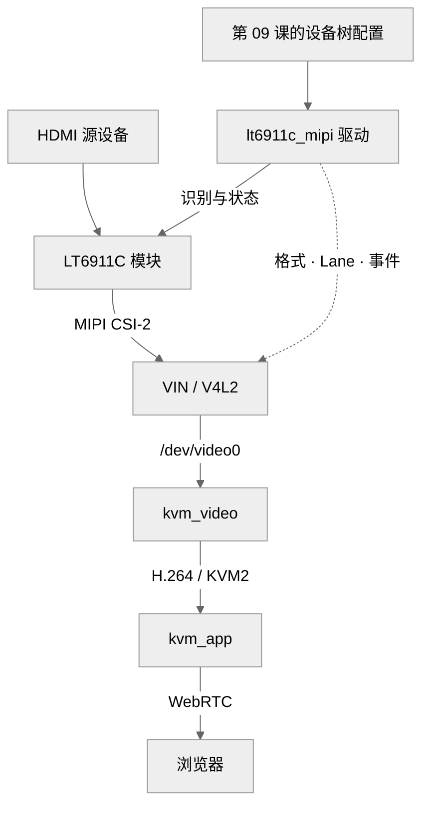

# 检查 LT6911C 驱动

SDK 已经编好 LT6911C 驱动，并由启动脚本自动加载。这一课检查它是否按上一课的设备树配置完成绑定、是否创建了 VIN 采集节点；正常流程不改驱动源码。只有换芯片、换模块或控制协议不同，才进入修改分支。

## 驱动在视频链路中的位置

LT6911C 驱动位于 HDMI 接收芯片和 VIN 主设备之间。它通过 I²C、GPIO 和设备树管理模块，并向 VIN 描述媒体总线格式、CSI-2 Lane 和输入事件；它不负责 H.264 编码，也不负责 WebRTC。



图 1：驱动在视频链路中的位置。本课只核对驱动和 VIN 这一段。

这张图同时标出了检查边界：驱动能否识别模块、能否向 VIN 提供格式和事件；编码、KVM2 和 WebRTC 属于后面的阶段。正常核对时不要为了“让图上的链路都通”去改驱动源码。

## 先确认配置和产物

驱动源码和内核配置已包含在 SDK 中：

```text
bsp/drivers/vin/modules/sensor/lt6911c_mipi.c
bsp/drivers/vin/modules/sensor/Kconfig
bsp/drivers/vin/modules/sensor/Makefile
device/config/chips/t527/configs/demo_linux_aiot/linux-5.15/bsp_defconfig
```

确认内核配置：

```bash
grep -n 'CONFIG_SENSOR_LT6911C' \
  device/config/chips/t527/configs/demo_linux_aiot/linux-5.15/bsp_defconfig
```

配套配置应为 `CONFIG_SENSOR_LT6911C=m`。再确认当前产物中有模块：

```bash
find out/t527/demo_linux_aiot -name 'lt6911c_mipi.ko'
```

参考路径是：

```text
out/t527/demo_linux_aiot/buildroot/lib/modules/5.15.147/lt6911c_mipi.ko
```

只使用现有镜像时不需要重新编译；修改过驱动或内核配置后，才在 SDK 根目录执行 `./build.sh`（完整构建），再核对模块。依赖和构建步骤见[准备开发环境](../preparation/development-environment.md)，部署见[部署与开机启动](../deployment/startup.md)。

## 确认板端已经加载并绑定

板端启动脚本 `S91camera` 会先加载 `vin_io`，再加载 `lt6911c_mipi`，最后加载 `vin_v4l2`。检查模块：

```sh
lsmod | grep -E 'lt6911|vin'
```

本次样机的相关输出：

```text
lt6911c_mipi  20480   0
vin_io        61440   3 vin_v4l2,lt6911c_mipi
vin_v4l2      249856  1
```

模块参数应和上一课确认的硬件一致：

```sh
cat /sys/module/lt6911c_mipi/parameters/reset_tied_high
cat /sys/module/lt6911c_mipi/parameters/refclk_hz
```

本次输出分别为 `Y` 和 `24000000`。`Y` 表示 RSTN 固定为高电平，驱动不操作复位 GPIO；24 MHz 对应模块本地晶振。

I²C 设备应已经绑定到驱动：

```sh
cat /sys/bus/i2c/devices/3-002b/name
readlink /sys/bus/i2c/devices/3-002b/driver
```

输出 `lt6911c_mipi` 并指向同名驱动，说明设备树里的 `0x56`、TWI3 和驱动匹配都生效了。

## 确认 VIN 采集节点

```sh
ls -l /dev/video0
cat /sys/class/video4linux/video0/name
```

本次样机输出设备名为 `vin_video0`。驱动加载成功不等于已经有画面；这一步只确认 VIN 已经创建采集节点。

镜像里没有 `v4l2-ctl` 和 `media-ctl`，不要为了检查临时安装或替换板端工具。下一阶段会用自己的查询程序读取 `/dev/video0` 的能力和格式。

查看驱动日志：

```sh
dmesg | grep -Ei 'lt6911|sensor_detect|HDMI input' | tail -20
```

本次运行中能看到反复的输入状态：

```text
sunxi:vin:[INFO]: [lt6911c_mipi]HDMI input locked: 1920x1080@60 error=0
sunxi:vin:[INFO]: [lt6911c_mipi]HDMI input unavailable: ... error=-67
```

`locked` 表示模块已经识别到有效输入时序；`unavailable` 可能出现在源切换或重新检测的瞬间。判断要以持续出现的 `locked`、设备节点和实际画面为准，不能只截一条日志下结论。

## 读源码时看什么

正常核对不需要改驱动，但需要知道检查点对应哪段逻辑：

| 符号 | 检查点 |
| --- | --- |
| `sensor_probe()` | 子设备注册、检测工作初始化 |
| `sensor_detect()` | 通过 I²C 读取芯片 ID，确认 `0x1605` |
| `sensor_formats[]` | 媒体总线格式 `MEDIA_BUS_FMT_UYVY8_2X8` |
| `sensor_g_mbus_config()` | CSI-2 D-PHY、四条数据 Lane、虚拟通道 0 |
| `sensor_det_init()` | 参考时钟、检测 GPIO 和 IRQ |
| `lt6911c_get_detected_timings()` | 输入宽高、像素时钟和帧率 |

当前 `sensor_default_regs` 为空，LT6911C 模块内部固件负责 HDMI/MIPI 初始化。芯片 ID 读取成功只能证明 I²C 控制通路可用，不代表 HDMI 已经锁定。

## 只有换芯片或换模块才改驱动

先改设备树，再考虑驱动：

- 只换板级接线、I²C、GPIO 或参考时钟：回到上一课修改 `board.dts`。
- 换用芯片 ID、I²C 控制协议、媒体总线格式或 CSI Lane 不同的模块：才需要修改 `lt6911c_mipi.c`。
- 修改后重新执行 `./build.sh`，核对 `.ko` 的内核版本与板端 `uname -r` 一致，再部署和加载。

不要为了“让检查通过”复制一份驱动或改探测逻辑；先确认硬件和配置本身是否一致。

## 常见故障

| 现象 | 先查哪里 | 常见原因 |
| --- | --- | --- |
| `lsmod` 没有 `lt6911c_mipi` | `S91camera` 和模块文件 | 启动脚本未执行、模块缺失或 `insmod` 失败 |
| `3-002b` 不存在 | 上一课设备树 | TWI 编号、地址、供电或复位配置不符 |
| 模块已加载但芯片 ID 失败 | `sensor_detect()`、I²C 日志 | 总线选错、地址不对、RSTN 未释放或模块未上电 |
| 没有 `/dev/video0` | `vin_io`、`vin_v4l2`、DTB | VIN 模块或设备树未生效 |
| 有 `/dev/video0` 但没有帧 | 下一课 HDMI 输入 | 源未输出、HPD/EDID 或 MIPI 链路异常 |

## 验收

- `CONFIG_SENSOR_LT6911C=m`，产物中存在 `lt6911c_mipi.ko`。
- 板端 `lsmod` 能看到 `lt6911c_mipi`、`vin_io`、`vin_v4l2`。
- `3-002b` 已绑定驱动，参数为 `Y`、`24000000`。
- `/dev/video0` 存在，名称为 `vin_video0`。
- 没有为了检查修改驱动源码。

下一课核对 HDMI 源、HPD 和输入锁定，确认这条链路真的有画面。
