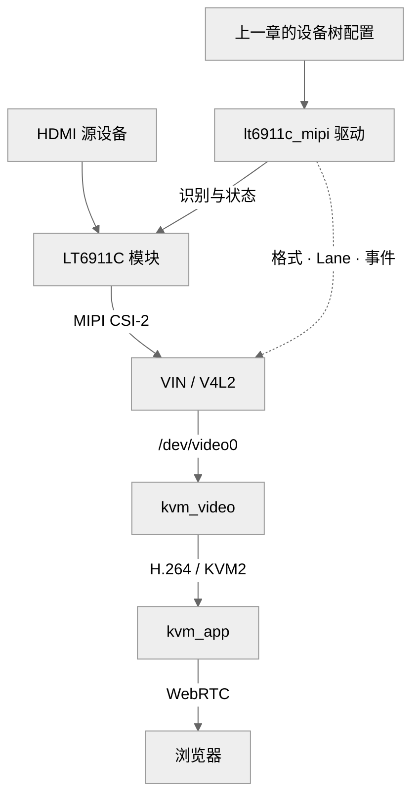

# 适配 LT6911C 驱动

上一章已经把原理图中的 I²C、GPIO、时钟和 VIN 节点写入设备树。本章承接那份设备树配置，专门处理 LT6911C 的 Linux 子设备驱动：阅读源码、确认内核配置、加载模块，并验证它是否已经接入 VIN。设备树字段和 DTB 核对请回到[适配设备树](/docs/course/drivers/device-tree)；HDMI 源设备、HPD、EDID 和输入锁定放在下一章[检查 HDMI 是否真的有输入](/docs/course/drivers/hdmi-signal)。

## 驱动在视频链路中的位置

LT6911C 驱动位于 HDMI 接收芯片和 VIN 主设备之间。它通过 I²C、GPIO 和设备树管理模块，并向 VIN 描述媒体总线格式、CSI-2 Lane 和输入事件；它不负责 H.264 编码，也不负责 WebRTC。



本章只验证驱动和 VIN 这一段：芯片能否被识别，驱动能否绑定，VIN 能否创建采集节点。`/dev/video0` 出现后，还要按后续章节检查 HDMI 输入和实际图像帧。

## 驱动源码

源码文件是 `bsp/drivers/vin/modules/sensor/lt6911c_mipi.c`。先按下面的顺序阅读，再决定是否需要改 C 文件：

| 符号 | 作用 |
| --- | --- |
| `sensor_probe()` | 分配状态对象、注册 V4L2 子设备、启动检测工作 |
| `sensor_detect()` | 通过 I²C 读取芯片 ID，确认 `0x1605` |
| `sensor_formats[]` | 声明媒体总线格式 `MEDIA_BUS_FMT_UYVY8_2X8` |
| `sensor_g_mbus_config()` | 声明 CSI-2 D-PHY、四条数据 Lane 和虚拟通道 0 |
| `sensor_det_init()` | 读取设备树中的参考时钟，申请检测 GPIO 和 IRQ |
| `lt6911c_get_detected_timings()` | 读取输入宽高、像素时钟和帧率 |
| `sensor_det_exit()` | 释放 IRQ、延迟工作和 GPIO |

当前 `sensor_default_regs` 为空，LT6911C 模块内部固件负责 HDMI/MIPI 功能初始化。换到同类模块时，如果只是板级接线不同，应先改上一章的设备树；只有芯片 ID、I²C 控制协议、媒体总线格式或 CSI 配置不同，才需要修改这里的驱动源码。

## 内核配置与编译

### 配置项

驱动已经接入内核构建系统：

```text
bsp/drivers/vin/modules/sensor/lt6911c_mipi.c
bsp/drivers/vin/modules/sensor/Kconfig
bsp/drivers/vin/modules/sensor/Makefile
```

参考板的内核配置是：

```text
device/config/chips/t527/configs/demo_linux_aiot/linux-5.15/bsp_defconfig
CONFIG_SENSOR_LT6911C=m
```

`Kconfig` 中的 `CONFIG_SENSOR_LT6911C` 通过 `Makefile` 生成 `lt6911c_mipi.ko`。如果驱动已经存在，通常只需要确认配置为 `m`；不要为了板级 GPIO 或时钟差异复制一份驱动。

### 编译产物

完整的 SDK 构建入口和部署方法见[准备 SDK 和基础镜像](/docs/course/drivers/sdk-build)。修改驱动源码或内核配置后，在 SDK 根目录重新生成内核模块：

```bash
source build/envsetup.sh
./build.sh kernel
find out/t527/demo_linux_aiot -name 'lt6911c_mipi.ko'
```

参考构建的模块位于：

```text
out/t527/demo_linux_aiot/buildroot/lib/modules/5.15.147/lt6911c_mipi.ko
```

部署前确认 `.ko` 的内核版本与板端 `uname -r` 一致。设备树修改后的 DTB 仍按上一章的方式检查，不在本章重复展开。

## 驱动加载

### 加载顺序与参数

VIN 依赖 LT6911C 子设备提供的格式和状态，因此参考镜像中的启动顺序是：

```sh
modprobe vin_io
insmod /lib/modules/$(uname -r)/lt6911c_mipi.ko \
  reset_tied_high=1 refclk_hz=24000000
modprobe vin_v4l2
```

这对应 SDK 中的 `buildroot/100ask/etc/init.d/S91camera`。参数值沿用上一章确认的硬件连接：

| 参数 | 参考值 | 使用条件 |
| --- | --- | --- |
| `reset_tied_high` | `1` | RSTN 固定为高电平；有 `reset_gpios` 时去掉 |
| `refclk_hz` | `24000000` | 模块使用 24 MHz 参考时钟；27 MHz 模块改为 `27000000` |

### 加载结果检查

```sh
lsmod | grep -E 'lt6911|vin'
cat /sys/module/lt6911c_mipi/parameters/reset_tied_high
cat /sys/module/lt6911c_mipi/parameters/refclk_hz
dmesg | grep -Ei 'lt6911|sensor_detect|vin|mipi|HDMI detection'
```

先处理模块加载错误，再进入 HDMI 输入检查。GPIO5 的边沿只表示输入状态可能发生变化，不代表已经有有效画面。

## 内核视频链路验证

### 芯片识别与驱动绑定

设备树中的 I²C 总线和地址沿用上一章；参考板在 sysfs 中对应 `3-002b`：

```sh
cat /sys/bus/i2c/devices/3-002b/name
readlink /sys/bus/i2c/devices/3-002b/driver
dmesg | grep -Ei 'lt6911|chip found|sensor_detect|i2c'
```

通过条件：设备节点存在，`name` 为 `lt6911c_mipi`，驱动链接已建立，芯片 ID `0x1605` 读取成功。芯片 ID 成功只证明 I²C 控制通路可用，不代表 HDMI 输入已经锁定。

### VIN 和媒体链路

```sh
test -e /dev/video0 && echo 'video node exists'
media-ctl -p 2>/dev/null || echo 'media-ctl unavailable'
v4l2-ctl --all -d /dev/video0 2>/dev/null || echo 'v4l2-ctl unavailable'
```

如果镜像没有 `media-ctl` 或 `v4l2-ctl`，下一阶段的采集示例也可以完成基础验证。这里要确认的是 VIN 已注册采集节点并能返回能力信息；实际格式和第一帧图像放到后续 V4L2 章节确认。

## 与后续章节衔接

完成驱动加载和 VIN 节点检查后，按课程顺序继续：

1. 在[检查 HDMI 是否真的有输入](/docs/course/drivers/hdmi-signal)中确认源设备输出、HPD、EDID 和模块锁定状态。
2. 在“查询采集格式”中读取 `/dev/video0` 的实际 V4L2 格式。
3. 在“采集第一帧图像”中完成 `QBUF/DQBUF`，确认 VIN 真正收到帧。
4. 再由 `kvm_video` 读取帧、编码 H.264，并交给 `kvm_app` 通过 WebRTC 显示。

因此，本章的结束位置是“驱动已绑定、VIN 节点已建立”，不是在这里重复完成整套 Web KVM。

## 常见故障

| 现象 | 先查哪里 | 常见原因 |
| --- | --- | --- |
| `insmod` 返回 `-EINVAL` | 模块参数和检测节点 | 参考时钟不是 24/27 MHz，检测 GPIO 缺失，复位参数与上一章的接线不一致 |
| I²C 设备节点不存在 | 上一章的设备树配置 | 总线、地址、供电或复位配置错误 |
| 模块加载但芯片 ID 失败 | `sensor_detect()` 和 I²C 日志 | 总线选错、地址不匹配、RSTN 未释放或模块未上电 |
| 驱动已绑定但没有 `/dev/video0` | `vin_io`、`vin_v4l2` 和 DTB | VIN 模块未加载、设备树产物未更新或内核配置未启用 |
| `/dev/video0` 存在但没有帧 | 下一章 HDMI 输入和后续 V4L2 章节 | 源设备未输出、HPD/EDID 异常、MIPI 链路或实际格式不匹配 |

## 源码索引

| 文件或符号 | 阅读重点 |
| --- | --- |
| `sensor_probe()` | 子设备注册和检测工作初始化 |
| `sensor_detect()` | 芯片 ID 和 I²C 读写 |
| `sensor_det_init()` | 参考时钟、检测 GPIO 和 IRQ |
| `sensor_formats[]` | 媒体总线格式 |
| `sensor_g_mbus_config()` | CSI-2 Lane 和虚拟通道 |
| `lt6911c_get_detected_timings()` | 输入时序读取 |
| `sensor_det_exit()` | 资源释放顺序 |
