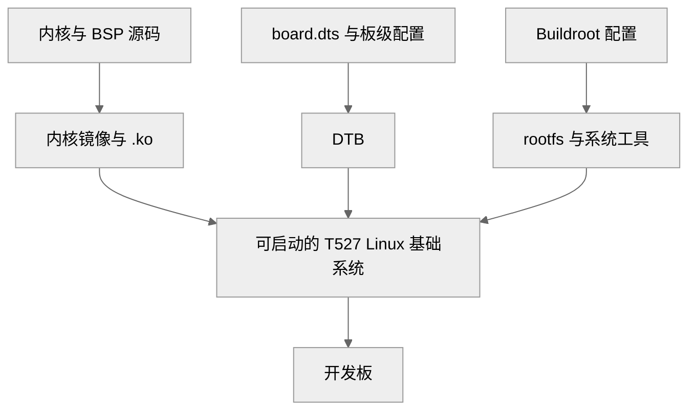

# 准备 SDK 和基础镜像

阶段二先做这一步，是因为后面的设备树和驱动修改必须有一套**能启动、能登录、能加载模块的基线系统**。本章构建和部署的是 T527 的 Linux 基础镜像，不是 `kvm_video`，也不是完整的 Web KVM 应用。

## 本章构建什么

| 源码或配置 | 构建产物 | 板端用途 |
| --- | --- | --- |
| Linux 内核与 BSP 驱动 | 内核镜像、`.ko` 模块 | 启动 Linux，提供 VIN 和其他设备驱动 |
| `board.dts` 与板级配置 | DTB | 启动时描述 I²C、GPIO、VIN 等硬件连接 |
| Buildroot 配置 | rootfs、工具和库 | 提供登录、调试和后续实验所需的用户空间 |
| 打包配置 | boot 镜像和整板镜像 | 写入开发板，启动参考系统 |



本章结束时，只需要确认开发板能够启动、通过串口登录、识别基本设备，并能使用后续章节需要的构建工具。视频采集、硬件编码和 WebRTC 会在后面的阶段逐步加入。

## 从 SDK 入口构建

在 SDK 根目录确认 `.buildconfig` 已选择目标板，再使用 SDK 自带的构建入口：

```bash
source build/envsetup.sh
./build.sh kernel
./build.sh dtb
```

`kernel` 负责内核和 BSP 驱动，`dtb` 负责板级设备树。需要生成整板镜像时，再按 SDK 的打包入口执行：

```bash
./build.sh pack
```

首次配置或更换板型时，按 SDK 配套说明选择板型，不要直接复制其他板的 `.buildconfig`。这些命令只负责生成基础系统，不能替代后续章节的设备树、驱动和采集实验。

## 基础镜像部署

从 `out/t527/demo_linux_aiot/` 找到本次构建的启动产物和打包文件，按照开发板已有的烧录方式部署。不要在本章手工替换正在运行的服务，也不要把尚未验证的 `kvm_video` 放进基础镜像。

部署后先通过串口完成最小检查：

```sh
uname -a
cat /proc/device-tree/model
ls /dev
```

通过条件是板子能稳定启动并登录，内核版本、板级型号和用户空间与本次构建一致。串口连接和网络准备沿用前面的硬件准备章节。

## 构建产物核对

```bash
find out/t527/demo_linux_aiot \
  \( -name '*.dtb' -o -name '*.ko' -o -name 'rootfs.*' -o -name 'boot.img' \) \
  -print
```

文件存在可能只是上一次构建的结果。修改后要同时核对构建退出状态、时间戳和 SHA-256；设备树还要在下一章反编译检查，驱动模块要在加载时核对 `vermagic` 和依赖。

| 产物 | 下一步由谁使用 | 本章检查什么 |
| --- | --- | --- |
| DTB | Linux 启动流程 | 板型和文件版本正确 |
| 内核与 `.ko` | Linux 和模块加载器 | 内核版本、架构和依赖匹配 |
| rootfs | 板端用户空间 | 能登录，拥有调试工具和启动脚本 |
| boot/整板镜像 | 烧录工具 | 能启动到当前板型 |

## 与下一章衔接

基础系统启动后，进入[适配设备树](/docs/course/drivers/device-tree)，把原理图中的实际连接写入板级配置。设备树确认后，才进入 LT6911C 驱动和 VIN 验证。
