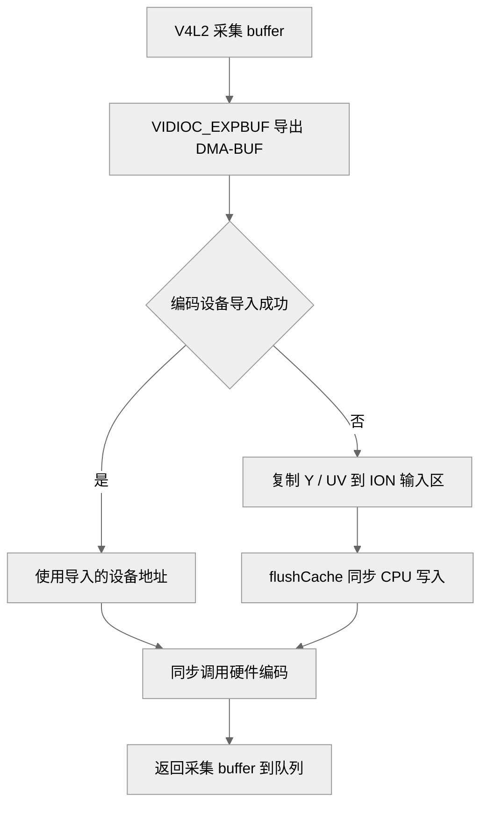

# 把采集缓冲区交给硬件编码器

采集下来的 NV12 每帧约 3 MB，如果先复制一份再编码，内存带宽和 CPU 都要多付一次。T527 的 VIN 和编码器都能访问物理内存，可以让它们共用同一块缓冲区。这一课把采集帧导出成 DMA-BUF，导入编码器所在的地址空间，直接编码一帧，确认这条路能走通。

## 两条输入路径

V4L2 的 MMAP 地址供 CPU 访问，硬件编码器需要的是自己能够访问的设备地址。**导入**是把采集缓冲区导出成 DMA-BUF，再映射到编码器地址空间，全程不复制；**复制**是把 Y/UV 拷到编码器能访问的 ION 缓冲区，再用 `flushCache` 同步 CPU 写入。正式服务优先导入，导入失败时回退到复制。



图 1：采集缓冲区的两条编码路径。

这一课先走导入路径：导入失败就报错退出，不悄悄改成复制。复制回退需要额外的 ION 分配和缓存同步，放在正文最后说明。

## 导出与导入

采集到一帧后，用 `VIDIOC_EXPBUF` 把这块 buffer 导出成一个 fd：

```cpp
struct v4l2_exportbuffer exp = {0};
exp.type = type;
exp.index = buf.index;
exp.plane = 0;
exp.flags = O_CLOEXEC;
if (xioctl(fd, VIDIOC_EXPBUF, &exp) < 0) {
	perror("VIDIOC_EXPBUF");
	goto out;
}
```

`exported_fd` 指向的就是这一帧所在的 DMA 内存。VIN 的物理地址不能直接交给编码器，两个设备看到的地址空间不同，所以要经过 `/dev/cedar_dev` 导入：

```cpp
struct CedarDmaBuf {
	int fd;
	unsigned int phy_addr;
};
static const unsigned long CEDAR_MAP_DMA_BUF = 0x504;
static const unsigned long CEDAR_UNMAP_DMA_BUF = 0x505;

ve_fd = open("/dev/cedar_dev", O_RDWR | O_CLOEXEC);
struct CedarDmaBuf mapping = {exported_fd, 0};
if (ioctl(ve_fd, CEDAR_MAP_DMA_BUF, &mapping) < 0) {
	perror("CEDAR_MAP_DMA_BUF");
	goto out;
}
```

返回的 `mapping.phy_addr` 才是编码器能用的地址。这两个 ioctl 号来自 Tina 5.0 的 cedar-ve UAPI（`bsp/drivers/ve/cedar-ve/cedar_ve.h`），不是通用 V4L2 接口，换 SDK 要重新核对。

本板实测导出和导入都成功：

```text
captured: index=0 sequence=2 bytesused=3133440
VE import: fd=4 phy=0xfe400000
```

## 编码器初始化

编码参数用 `EncodeParam` 描述，和正式服务保持一致：

```cpp
param.codecType = CODEC_H264;
param.pixelFormat = PIXEL_YUV420SP;   /* NV12 */
param.srcW = WIDTH;
param.srcH = HEIGHT;
param.dstW = WIDTH;
param.dstH = HEIGHT;
param.bitRate = BITRATE_KBPS * 1000;
param.frameRate = 60;
param.maxKeyFrame = 60;
param.frameCount = MULTI_FRAMES;
param.rcMode = VBR;
param.minQp = 20;
param.maxQp = 28;
```

`frameCount` 用 `MULTI_FRAMES` 表示连续编码，`rcMode` 选 VBR，`maxKeyFrame=60` 让关键帧最长一秒一个。`init()` 会立即通过回调返回 SPS/PPS，之后每编一帧再回调一次码流。

## 交付一帧

回调的实现只需要数清楚收到了什么：

```cpp
int encoderDataReady(AVPacket *packet) override
{
	if (!packet || !packet->pAddrVir0 || !packet->dataLen0)
		return -1;
	if (packet->pts == -1) {
		config_bytes += packet->dataLen0 + packet->dataLen1;
		return 0;
	}
	frames++;
	total_bytes += packet->dataLen0 + packet->dataLen1;
	return 0;
}
```

`pts == -1` 的是配置包（SPS/PPS），不计入图像帧。H.264 的码流通常只在 `data0` 里，`data1` 留给 JPEG 的第二段。回调里的指针只在本次调用期间有效，要保存必须自己拷贝。

**回调里的 `isKeyframe` 不能用**：SDK 封装里的输出 `AVPacket` 没有初始化，这个字段从未赋值，读到的是栈上残值。要判断关键帧只能自己解析码流，下一课会按 Annex-B 的 NAL 类型数 IDR。

喂给编码器的地址按 Y/UV 两段填写：

```cpp
packet.pAddrPhy0 = (unsigned char *)(uintptr_t)imported_phy;
packet.dataLen0 = WIDTH * HEIGHT;
packet.pAddrPhy1 = (unsigned char *)(uintptr_t)(imported_phy + WIDTH * HEIGHT);
packet.dataLen1 = WIDTH * HEIGHT / 2;
packet.pts = 0;
packet.isKeyframe = true;
```

UV 从 `width*height` 开始，不是第 12 章里那个 `bytesperline` 值。`isKeyframe=true` 请求这一帧编成 IDR。

`encode()` 是同步调用，返回时回调已经执行完。**在这之前不能 QBUF**，否则采集硬件可能重写编码器还没读完的画面。返回后再把 buffer 还给驱动。

## 回收顺序

释放顺序和申请相反：先解除 VE 映射并关闭导出的 fd，再销毁编码器，最后停流、解除 `mmap`、释放 V4L2 缓冲区：

```cpp
if (ve_fd >= 0 && imported_phy)
	ioctl(ve_fd, CEDAR_UNMAP_DMA_BUF, &unmap);
close(ve_fd);
close(exported_fd);
AWVideoEncoder::destroy(encoder);
VIDIOC_STREAMOFF;
munmap;
VIDIOC_REQBUFS(count=0);
close(fd);
```

先关导出 fd 再解除映射，或者反过来漏掉一步，都会让这块内存的引用计数对不上，下一次采集可能拿不到缓冲区。

## 编译与运行

把上面这些步骤写成程序就是 [15-encode-buffer](/examples/kvm/04-encoding/15-encode-buffer/encode_buffer.cpp)，课件里的版本可以对照。

### 编译

它要链接 SDK 的编码库，用 SDK 的 `g++` 编译：

```bash
make SDK_ROOT=~/T527_Tina5.0_SDK
"${CROSS_COMPILE}readelf" -h encode_buffer | grep Machine
"${CROSS_COMPILE}readelf" -d encode_buffer | grep NEEDED
```

`Machine` 应是 `AArch64`；`NEEDED` 里会列出 `libvencoder.so`、`libsdk_memory.so` 等，这些库由配套镜像的 `/usr/lib` 提供。板端没有编译器，程序在开发主机编好后传上去。

### 传到板子

在开发主机进入课件目录起临时 HTTP 服务：

```bash
cd <课件目录>
python3 -m http.server 8000
```

板端下载并和主机 `md5sum` 对照：

```sh
wget -q -O /tmp/encode_buffer http://192.168.1.69:8000/encode_buffer
chmod +x /tmp/encode_buffer
md5sum /tmp/encode_buffer
```

### 板端运行

先停 KVM，再运行：

```sh
/etc/init.d/S99kvm stop
./encode_buffer /dev/video0
/etc/init.d/S99kvm start
```

## 板端输出

```text
waiting for HDMI input...
input locked: 1920x1080@60
buffers=4 sizeimage=3133440 bytesperline=2880
captured: index=0 sequence=2 bytesused=3133440
VE import: fd=4 phy=0xfe400000
config: data0=24 data1=0
encoder: H.264 1920x1080 60fps 12000kbps VBR QP 20-28
frame=1 data0=14026 data1=0
encode: ret=0 elapsed=8.5ms config=24B frames=1 bytes=14026
```

24 字节配置包是 SPS/PPS，14,026 字节是这一帧的 IDR 码流。8.5 ms 是同步编码调用加上回调的耗时，不是端到端延迟；连续编码的吞吐在性能课里单独测。

编码器初始化时可能打印 `open plugin 'utils.so' failure` 和 VE 调频的 `can not match dvfs` 信息。前者是可选插件缺失，后者是默认频率回退，本板编码正常完成。

## 复制回退

导入失败时，改成复制也能编码，代价是多一次内存拷贝：

1. 用 SDK 的内存接口分配一块 ION 缓冲区，拿到 CPU 地址和物理地址；
2. 把采集帧的 Y 和 UV 两段 `memcpy` 进去；
3. 调用 SDK 的缓存同步接口刷 cache，让设备读到 CPU 写入的数据；
4. 用 ION 的物理地址填 `pAddrPhy0`、`pAddrPhy1` 再编码。

这条路径兼容性更好，但每一步都要自己保证：缓冲区的宽和高都按 16 对齐后再算容量（1920×1088×1.5 = 3,133,440 字节），拷贝长度和报告长度一致，缓存同步不能省。这一课没有实现它，是为了让导入路径的问题直接暴露出来；确认导入成功后，可以按上面的步骤自己补一条回退分支，并在日志里区分走的是导入还是复制。

## 验收

- `VIDIOC_EXPBUF` 和 `CEDAR_MAP_DMA_BUF` 都成功，打印出非零物理地址；
- 编码器初始化后收到 24 字节左右的 SPS/PPS；
- 编码一帧返回 0，回调收到一帧码流，字节数大于 0；
- 退出后 `/dev/video0` 能再次打开，`/etc/init.d/S99kvm start` 后服务正常。

## 常见问题

| 现象 | 原因 | 处理 |
| --- | --- | --- |
| `VIDIOC_EXPBUF` 失败 | 缓冲区不是 MMAP 导出类型，或索引不对 | 确认 `REQBUFS` 用 `V4L2_MEMORY_MMAP`，索引来自本次 DQBUF |
| `CEDAR_MAP_DMA_BUF` 失败 | `/dev/cedar_dev` 没打开或 fd 无效 | 检查设备节点和导出 fd |
| 编码器 init 失败 | 库没加载或参数越界 | 检查 `/usr/lib` 下的编码库和 QP/码率范围 |
| 只有配置包，没有图像帧 | `encode()` 没调用或返回失败 | 看 `encode ret` 和回调里的 `pts` |
| 画面花屏或错位 | UV 起点或长度不对 | UV 从 `width*height` 开始，长度是 `width*height/2` |

下一课把回调里的码流按 Annex-B 写进文件，用 FFmpeg 解码确认画面。
