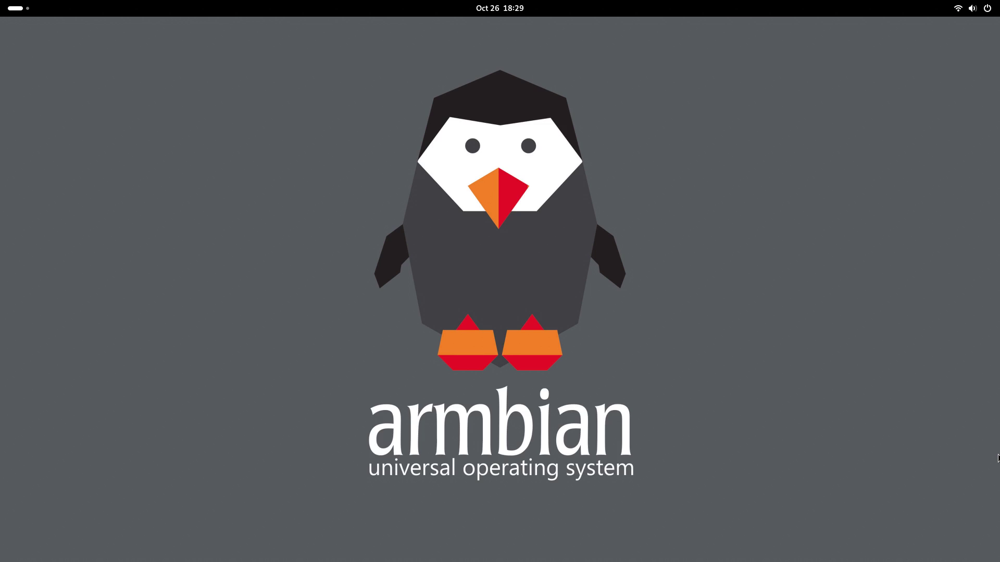

# 生成 H.264 码流

上一课只编码了一帧，回调里的数据看完就丢了。要把画面留下来，就得在回调里把码流写进文件。这一课连续采集 120 帧，写成 Annex-B H.264，再用 FFmpeg 解码确认画面正确。

## Annex-B 码流的组成

编码器输出的是 Annex-B 格式：每个 NAL 单元前面有 `00 00 01` 或 `00 00 00 01` 起始码。一个可播放的文件需要三类内容：

| 内容 | NAL 类型 | 作用 |
| --- | --- | --- |
| SPS / PPS | 7 / 8 | 解码参数，文件开头必须有一份 |
| IDR 帧 | 5 | 关键帧，刷新参考状态，新解码从这里开始 |
| P 帧 | 1 | 参考前面的帧，体积比 IDR 小 |

编码器初始化的回调就是 SPS/PPS（`pts == -1`），之后每次 `encode()` 回调一帧码流。两部分都按顺序写进同一个文件，才是完整的流。

## 打开输出文件

文件在编码器初始化之前打开，排他创建，避免覆盖上一次实验：

```cpp
out_fd = open(out_path, O_WRONLY | O_CREAT | O_EXCL, 0644);
if (out_fd < 0) {
	perror("open output");
	goto out;
}
writer.fd = out_fd;
```

这样编码器 `init()` 第一次回调 SPS/PPS 时，文件已经就绪。

## 缓冲区的循环与编码

DMA-BUF 在启动阶段一次性导入所有采集缓冲区，循环里只按 `buf.index` 取对应物理地址：

```cpp
packet.pAddrPhy0 = (unsigned char *)(uintptr_t)buffers[buf.index].phy;
packet.dataLen0 = WIDTH * HEIGHT;
packet.pAddrPhy1 = (unsigned char *)(uintptr_t)(buffers[buf.index].phy +
						WIDTH * HEIGHT);
packet.dataLen1 = WIDTH * HEIGHT / 2;
packet.pts = captured * 1000 / FPS;
packet.id = (unsigned long)captured;
packet.isKeyframe = (captured % FPS == 0);
```

每帧都导出、导入一次也能工作，但每个缓冲区只映射一次更接近正式服务，也少一层系统调用。`isKeyframe` 在输入侧是有效的，设为 true 会请求编码器把这一帧编成 IDR；本课每 60 帧请求一次，和一秒一个关键帧的目标一致。

`encode()` 同步返回后才 QBUF，顺序和上一课一样。

## 回调里写文件

写文件放在回调里完成，两段数据按编码器给出的顺序写：

```cpp
int encoderDataReady(AVPacket *packet) override
{
	if (!packet || !packet->pAddrVir0 || !packet->dataLen0)
		return -1;
	if (write_all(fd, packet->pAddrVir0, packet->dataLen0) < 0)
		return -1;
	if (packet->dataLen1 &&
	    write_all(fd, packet->pAddrVir1, packet->dataLen1) < 0)
		return -1;
	...
}
```

回调返回后编码器就会复用这块输出内存，所以必须在返回前写完。写失败要把错误带出去，让主循环停下，不能留下半截文件还报告成功。

配置包也要写，判断条件是 `pts == -1`：

```cpp
if (packet->pts == -1) {
	config_bytes += packet->dataLen0 + packet->dataLen1;
	return 0;
}
frames++;
```

## 关键帧的判断

上一课留了一个坑：SDK 封装里的输出 `AVPacket` 没有初始化，**回调里的 `isKeyframe` 从未赋值**，读到的是栈上残值。第一次跑这一课时它把所有帧都报成关键帧，实际不是。

判断 IDR 只能看码流本身：扫描起始码，取后面的 `nal_unit_type`，等于 5 就是 IDR。

```cpp
static int count_idr(const unsigned char *data, size_t size)
{
	int idrs = 0;
	size_t i = 0;
	while (i + 3 <= size) {
		size_t sc = 0;
		if (data[i] == 0 && data[i + 1] == 0 && data[i + 2] == 1)
			sc = 3;
		else if (i + 4 <= size && data[i] == 0 && data[i + 1] == 0 &&
			 data[i + 2] == 0 && data[i + 3] == 1)
			sc = 4;
		if (!sc) { i++; continue; }
		if (i + sc < size && (data[i + sc] & 0x1f) == 5)
			idrs++;
		i += sc;
	}
	return idrs;
}
```

120 帧、每 60 帧请求一次 IDR，实测 `idr=2`，和第 0、60 帧对上。

## 编译与运行

把前面的采集、导入、回调和写文件连起来，就是 [16-h264-file](/examples/kvm/04-encoding/16-h264-file/h264_file.cpp)，课件里的版本可以对照。

### 编译

编译时把 SDK 自带的编码封装源码一起编进去（Makefile 里已写好路径），并定义级别：

```make
DEFINES := -DUSE_LOGCAT -DLOG_LEVEL=3 -DKVM_H264_LEVEL=VENC_H264Level42 \
           -DMODULE_VERSION=\"KVM-1080p60\"
```

**不要直接链接预编译的 `libsdk_encoder.so`**：它是默认级别，实测 SPS 里是 Level 5.1，和正式程序的 4.2 不一致。自己编封装源码才能把级别固定下来。

```bash
make SDK_ROOT=~/T527_Tina5.0_SDK
"${CROSS_COMPILE}readelf" -h h264_file | grep Machine
"${CROSS_COMPILE}readelf" -d h264_file | grep NEEDED
```

`Machine` 应是 `AArch64`，`NEEDED` 里是编码库；板端没有编译器，程序在开发主机编好后传上去。

### 传到板子

在开发主机进入课件目录起临时 HTTP 服务：

```bash
cd <课件目录>
python3 -m http.server 8000
```

板端下载并和主机 `md5sum` 对照：

```sh
wget -q -O /tmp/h264_file http://192.168.1.69:8000/h264_file
chmod +x /tmp/h264_file
md5sum /tmp/h264_file
```

### 板端运行

先停 KVM，再运行 120 帧：

```sh
/etc/init.d/S99kvm stop
./h264_file /dev/video0 /tmp/capture.h264 120
/etc/init.d/S99kvm start
```

## 板端输出

```text
waiting for HDMI input...
input locked: 1920x1080@60
buffers=4 sizeimage=3133440 bytesperline=2880
buffer[0] size=3133440 phy=0xfe400000
buffer[1] size=3133440 phy=0xfe000000
buffer[2] size=3133440 phy=0xfdc00000
buffer[3] size=3133440 phy=0xfd800000
encoding 120 frames to /tmp/capture.h264
captured=120 encoded=120 idr=2 elapsed=2.025s fps=59.27
file=/tmp/capture.h264 config=24B frames=865389B total=865413B
```

编码 120 帧用了 2.025 秒，和采集同步，没有拖慢帧率。865 KB 是这段静态桌面在 12 Mbps VBR 下的实际输出，画面变化大时会明显增加，不能当成固定码率。

## 验证码流

板端没有 `scp`，可以把文件复制到存储卡，或者用 base64 转成文本再走 HTTP 传回主机。**BusyBox 的 `wget --post-file` 按字符串处理，遇到码流里的 `00` 会截断**，直接用它会传 0 字节。

在主机上检查：

```bash
ffprobe -v error -f h264 -show_streams capture.h264
ffmpeg -f h264 -i capture.h264 -vf "select=eq(n\,90)" -frames:v 1 frame.png
```

本板文件的结果：

```text
codec_name=h264
profile=High
width=1920
height=1080
level=42
```

第 90 帧解码：



图 1：120 帧码流中第 90 帧经 FFmpeg 解码。时钟和桌面显示正常，说明 SPS/PPS、IDR 和 P 帧的写入顺序正确。

`ffplay -f h264 capture.h264` 可以直接播放这 120 帧。裸码流没有帧率信息，播放器会按自己的估计播放，不能拿播放速度当采集帧率。

## 验收

- 文件以 SPS/PPS 开头，`ffprobe` 能识别为 H.264 High、1920×1080、Level 4.2；
- 120 帧全部编码并写入，`idr=2`；
- 任意抽一帧解码，画面内容和 HDMI 源一致；
- 程序退出后设备空闲，KVM 服务能重新拉起。

## 常见问题

| 现象 | 原因 | 处理 |
| --- | --- | --- |
| 文件无法播放 | 没写 SPS/PPS，或写入了半截包 | 配置包（`pts == -1`）也要写，写失败要停下 |
| `ffprobe` 报 Level 5.1 | 链接了预编译的编码库（默认级别） | 改为编译 SDK 自带的封装源码并定义 `KVM_H264_LEVEL` |
| 所有帧都被报成关键帧 | 用了回调里的 `isKeyframe` | 按 NAL 类型 5 自己数 IDR |
| 传回主机的文件是 0 字节 | BusyBox `wget --post-file` 遇 NUL 截断 | 先 base64 再传，或走存储卡 |
| 画面花屏或错位 | UV 起点或长度错误 | UV 从 `width*height` 开始，长度 `width*height/2` |
| 文件比预期大很多 | 画面变化大，VBR 自动提高码率 | 这是正常现象，测码率要用固定内容和统计窗口 |

码流落盘确认后，下一阶段转向 USB 键鼠：把 T527 枚举成 HID 设备，用自己的程序发送键盘和鼠标报告。
