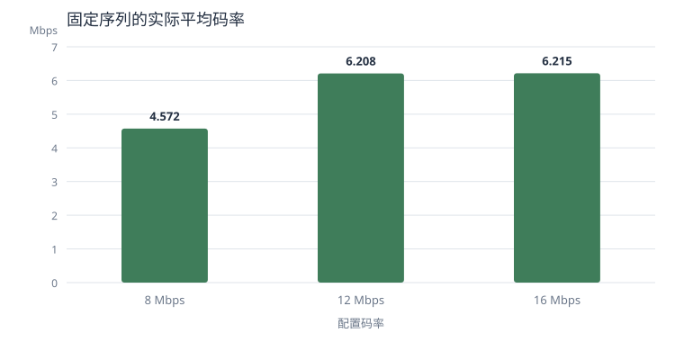
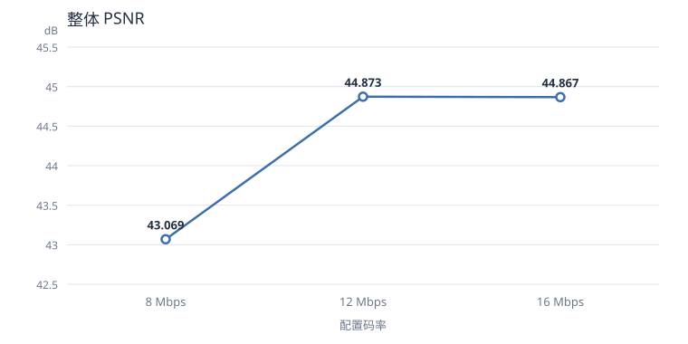
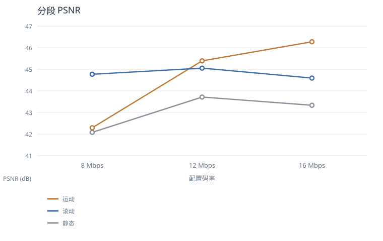

# 测量编码性能

编码器跟不跟得上 60 fps、实际码率是多少、提高码率值不值，这三个问题要用不同的测量回答。先在实时桌面上看编码耗时，再用固定序列比较码率和画质。

## 实时测量：编码耗时与帧率

每次 `encode()` 前后读 `CLOCK_MONOTONIC`，差值就是同步调用加输出回调的耗时，不含采集等待、缓冲区导入和写文件。实时测量记录最小值、平均值和最大值；60 fps 每帧的预算是 16.7 ms，用它判断编码器有没有拖慢采集。这个数字衡量编码吞吐，不是从 HDMI 到浏览器的端到端延迟。

这一课要写的程序采集并编码 300 帧，不写文件，只统计耗时、帧率和码率；完整版本是 [perf.cpp](/examples/kvm/04-encoding/17-performance/perf.cpp)，可以对照：

```sh
/etc/init.d/S99kvm stop
./perf /dev/video0 12000 300
/etc/init.d/S99kvm start
```

同一路 1080p60 桌面，8、12、16 Mbps 三档的 `encode()` 平均都是 8.52–8.54 ms，最大 8.69 ms；帧率 59.7–59.9。16.7 ms 的预算用掉一半左右，采集和 QBUF 还有余量。

实际码率由每帧回调的 `dataLen0 + dataLen1` 累加，再除以统计窗口；配置码率在 VBR 下只是上限。这段桌面基本静止，实际只有 3.63、4.45、4.79 Mbps，码率随配置提高但离上限很远。**静态画面不能用来比较画质**，要看码率和画质的取舍，得换固定内容。

## 固定序列：码率与画质

`base.nv12` 是一帧 1920×1080 的 NV12 参考图，里面有文字、彩色块、细线和纹理。程序按帧号对这些区域做整数位移：前 120 帧不动，中间 240 帧纵向滚动，后 240 帧横纵运动。每帧按 60 fps 节拍送进编码器，内容和时序都可重复。

写入 ION 缓冲区时按 **1920×1088×1.5 = 3,133,440 字节** 分配。编码器按 16 行对齐读取输入，按 1920×1080 紧密分配会越界，VE 会报 `L2 PageTable Invalid`。

主机上的 `reference` 生成同样的 600 帧参考 NV12。FFmpeg 解码 H.264 后逐帧对比：PSNR 由均方误差换算（10·log10(255²/MSE)），SSIM 比较结构相似度，报告的是 600 帧的平均值。两个指标只说明解码结果与参考帧的接近程度，不是主观画质的百分比。

用这段序列跑 8、12、16 Mbps 正序和反序各一轮，共 3600 帧：



图 1：配置 8/12/16 Mbps 时的实际平均码率。12 和 16 Mbps 的实际输出几乎相同，说明这段内容用不到更高的上限。



图 2：解码结果相对参考帧的整体 PSNR。SSIM 分别为 0.991257、0.995735、0.996261。



图 3：静态、滚动、运动三段的 PSNR。运动段在 12 Mbps 后提升明显，静态和滚动在 12 Mbps 已基本饱和。

从 8 Mbps 提到 12 Mbps，整体 PSNR 提高约 1.8 dB，编码耗时几乎不变（8.55、8.58、8.59 ms）。16 Mbps 的整体分数和 12 Mbps 持平，但运动段还能到 46.27 dB，说明高码率只在运动画面有收益。**所以默认用 12 Mbps**：静态和滚动已经够用，运动段也有明显改善。

两轮同档码流 md5 一致，六轮共 3600 帧没有编码错误。关键帧按 Annex-B 的 `nal_unit_type` 统计，等于 5 是 IDR；不依赖回调里的 `isKeyframe`，SDK 封装没有给这个字段赋值。

## 数据是怎么来的

三张图里的每个数字都能追到原始日志。

### 板端日志：RESULT 行

`quality_bench` 每跑完一轮打印一行 JSON。六轮里同档的字节数完全相同（正序和反序一致）：

```text
RESULT {"kbps":8000,"frames":600,"bytes":5714404,"actual_mbps":4.571523,"encode_avg_ms":8.5493,"encode_p95_ms":8.6369,"encode_p99_ms":9.0645,"encode_max_ms":9.6642,"over_16_67ms":0,"errors":0}
RESULT {"kbps":12000,"frames":600,"bytes":7760206,"actual_mbps":6.208165,"encode_avg_ms":8.5716,"encode_p95_ms":8.6772,"encode_p99_ms":9.8359,"encode_max_ms":10.0465,"over_16_67ms":0,"errors":0}
RESULT {"kbps":16000,"frames":600,"bytes":7768882,"actual_mbps":6.215106,"encode_avg_ms":8.5867,"encode_p95_ms":8.6870,"encode_p99_ms":10.1487,"encode_max_ms":10.3242,"over_16_67ms":0,"errors":0}
```

| 字段 | 含义 | 用在哪 |
| --- | --- | --- |
| `bytes` | 本轮码流总字节数，含 SPS/PPS | 算实际码率 |
| `actual_mbps` | `bytes × 8 ÷ (600/60) ÷ 1e6` | 图 1 的纵轴 |
| `encode_avg_ms`、`encode_p95_ms` | 每次 `encode()` 前后时间差的统计 | 表格里的编码耗时 |
| `over_16_67ms` | 超过 60 fps 预算的帧数 | 六轮都是 0 |
| `errors` | 编码失败次数 | 都是 0 |

### 主机日志：逐帧 PSNR 和 SSIM

FFmpeg 对 600 帧逐帧输出一行，用 `stats_file` 保存下来：

```text
n:1 mse_avg:7.11 mse_y:9.42 mse_u:2.94 mse_v:2.05 psnr_avg:39.61 psnr_y:38.39 psnr_u:43.45 psnr_v:45.02
n:2 mse_avg:6.66 mse_y:8.78 mse_u:2.77 mse_v:2.05 psnr_avg:39.90 psnr_y:38.70 psnr_u:43.71 psnr_v:45.02
...
n:600 mse_avg:0.37 mse_y:0.37 mse_u:0.39 mse_v:0.36 psnr_avg:52.43 psnr_y:52.47 psnr_u:52.19 psnr_v:52.53
```

```text
n:1 Y:0.986165 U:0.965496 V:0.975923 All:0.981013 (17.215452)
n:2 Y:0.986574 U:0.967992 V:0.976197 All:0.981747 (17.386725)
```

统计口径：

- **整体 PSNR**：把 600 帧的 `mse_avg` 取平均，再按 `10·log10(255² / mean(MSE))` 换算，就是图 2。
- **分段 PSNR**：第 1–120 帧是静态、121–360 是纵向滚动、361–600 是横纵运动；每段内部先平均 MSE 再换算，得到图 3 的三条线。
- **SSIM**：每帧取 `All` 值，段内直接平均。
- PSNR 是对数，先平均 MSE 再换算才反映整段的平均失真；如果先平均每帧 PSNR，结果会差零点几 dB，本文用的是前一种。

| 图 | 数据来源 |
| --- | --- |
| 图 1 实际码率 | RESULT 的 `actual_mbps` |
| 图 2 整体 PSNR | `.psnr` 文件的 600 行 `mse_avg` |
| 图 3 分段 PSNR | 分段平均 MSE 后换算 |
| 编码调用均值 | RESULT 的 `encode_avg_ms` |

## 复现固定序列

### 编译

程序和参考帧在 `17-performance/`：`encode_bench.cpp`、`sequence.h`、`reference.cpp`、`base.nv12`。一次 `make` 编出两个程序，注意它们跑在不同的机器上：

```bash
make SDK_ROOT=~/T527_Tina5.0_SDK
```

| 目标 | 编译器 | 运行位置 |
| --- | --- | --- |
| `quality_bench` | SDK 的 `aarch64-none-linux-gnu-gcc`（交叉编译） | T527 开发板 |
| `reference` | 开发主机的 `g++` | 开发主机 |

只编其中一个时直接指定目标：

```bash
make SDK_ROOT=~/T527_Tina5.0_SDK quality_bench
make reference
```

编完核对产物，别拿错架构：

```bash
file quality_bench reference
"${CROSS_COMPILE}readelf" -h quality_bench | grep Machine
```

`quality_bench` 应显示 `ELF 64-bit` 和 `ARM aarch64`，`reference` 是开发主机的 x86-64。**板端没有编译器**，所有板端程序都在开发主机交叉编译后再传上去。

### 传到板子

`quality_bench` 和 `base.nv12` 都要传。在开发主机进入课件目录起临时 HTTP 服务：

```bash
cd <课件目录>
python3 -m http.server 8000
```

板端下载并和主机 `md5sum` 对照：

```sh
mkdir -p /tmp/perf && cd /tmp/perf
wget -q -O quality_bench http://192.168.1.69:8000/quality_bench
wget -q -O base.nv12 http://192.168.1.69:8000/base.nv12
chmod +x quality_bench
md5sum quality_bench base.nv12
```

### 板端运行

停掉 KVM，按 8/12/16/16/12/8 Mbps 各跑一轮，每轮 600 帧约 10 秒：

```sh
/etc/init.d/S99kvm stop
./quality_bench base.nv12 8000  /tmp/r1-8000.h264
./quality_bench base.nv12 12000 /tmp/r1-12000.h264
./quality_bench base.nv12 16000 /tmp/r1-16000.h264
./quality_bench base.nv12 16000 /tmp/r2-16000.h264
./quality_bench base.nv12 12000 /tmp/r2-12000.h264
./quality_bench base.nv12 8000  /tmp/r2-8000.h264
/etc/init.d/S99kvm start
```

每次运行会打印一行 `RESULT {...}`，包含帧数、字节数、实际码率、编码耗时分位数和错误数。

### 主机分析

把 `.h264` 传回主机，用主机上编好的 `reference` 生成参考帧、通过管道喂给 FFmpeg，并把逐帧结果写进文件：

```bash
./reference base.nv12 | ffmpeg -f rawvideo -pix_fmt nv12 -s 1920x1080 -r 60 -i - \
  -r 60 -i r1-12000.h264 \
  -lavfi "[0:v]settb=AVTB,setpts=N/(60*TB),format=yuv420p[ref];[1:v]settb=AVTB,setpts=N/(60*TB),format=yuv420p[dec];[dec][ref]psnr=stats_file=r1-12000.psnr" \
  -f null -
```

SSIM 用同样一条命令，把 `psnr` 换成 `ssim`、统计文件换成 `.ssim`。然后按上面的口径汇总：

```bash
python3 - <<'EOF'
import math, re
mse = [float(re.search(r'mse_avg:([\d.]+)', l).group(1)) for l in open('r1-12000.psnr')]
for name, s, e in [('整体', 0, 600), ('静态', 0, 120), ('滚动', 120, 360), ('运动', 360, 600)]:
    m = sum(mse[s:e]) / (e - s)
    print(name, round(10 * math.log10(255 ** 2 / m), 3), 'dB')
EOF
```

`reference` 只跑在开发主机上，不要拷到板子；编出来的 `quality_bench` 才是板端程序。

## 结果边界

这些数字来自固定序列和实时桌面，不包含采集丢帧、网络传输和浏览器呈现。它不能证明 HDMI 采集稳定、网页能持续播放；端到端延迟要等阶段六接入 KVM2 视频 Socket 后单独测。

## 验收

- 实时桌面 300 帧的 `encode()` 不超过 16.7 ms，帧率在 59–60；
- 固定序列六轮 3600 帧无编码错误，两轮同档 md5 一致；
- 能解释为什么默认 12 Mbps，不把 PSNR 当成主观画质；
- 能区分编码耗时和端到端延迟。

到这里，编码这条链路的能力和边界已经清楚。下一阶段转向 USB 键鼠：把 T527 枚举成 HID 设备，用自己的程序发送报告。
