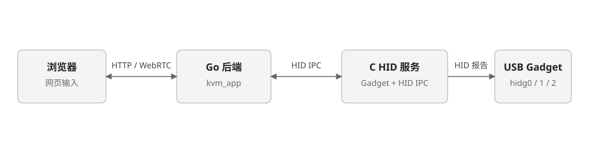

# 用 C 实现 HID 服务并接入 Go 后端

上一课把 C 视频端接进了 Go 后端，这一课做键鼠侧：用第 18–21 课的 Gadget 和 HID 报告知识，写一个 C 的 HID 服务，替换正式 `kvm_hid`，让 Go 后端把网页的键盘鼠标送进 `/dev/hidg*`，被控设备收到真实输入。

## 程序在系统里的位置



图 1：浏览器输入经 Go 后端、HID IPC 和 Gadget 到达被控设备。

| 部分 | 负责什么 | 本课是否实现 |
| --- | --- | --- |
| 浏览器 | 采集键盘、鼠标事件 | 直接使用网页 |
| Go 后端 | 会话、WebRTC、把输入转成 HID IPC 请求 | 使用现有程序，不改 |
| C HID 服务 | Gadget、HID 报告、HID IPC 服务端 | 本课编写 |
| 被控设备 | USB Host，接收键盘鼠标 | 用 evtest 验收 |

正常运行时 Go 后端是 HID IPC 的**客户端**，正式 `kvm_hid` 是服务端。本课把服务端换成自己的 C 程序；Go 后端不知道对端换了人，仍然按协议发 `configure`、`status` 和输入请求。

## HID 服务要做什么

### 配置 USB Gadget

服务启动后不立即建 Gadget，而是等 Go 后端发 `configure`，根据请求建立三个 HID 功能：

| 功能 | 报告长度 | 作用 |
| --- | --- | --- |
| 键盘 | 8 字节 | 修饰键、保留字节、6 个键码 |
| 绝对鼠标 | 6 字节 | Report ID 1、按键、16 位 X/Y；Report ID 2 滚轮 |
| 相对鼠标 | 4 字节 | 按键、有符号 X/Y、滚轮 |

描述符直接使用第 18 课的三份数据，写入 `report_desc`。Gadget 路径是 `/sys/kernel/config/usb_gadget/kvm`，绑定 UDC 后通过每个功能的 `dev` 属性找到实际的 `/dev/hidgN`，不能假设一定是 `hidg0/1/2`。

**配置相同的请求要复用现有 Gadget**，不要每次客户端连接都重建。重建会让被控设备重新枚举，evtest 已经打开的 fd 会失效，浏览器会话也可能短暂断开。只有设备集合或身份变化时才清理并重配。

### 提供 HID IPC

HID IPC 是 `/run/kvm/hid.sock` 上的按行 JSON，权限 `0600`：

- 只允许一个输入所有者；第二个连接直接收到错误并关闭。
- 第一条必须是 `configure`，否则返回 `configure handshake required`。
- 每条请求不超过 4096 字节，一次一个未完成请求。
- 3 秒没有新请求就断开并释放按键；Go 后端每 500 ms 发一次 `status` 续租。

`configure` 请求包含设备开关和 USB 身份：

```json
{"v":1,"op":"configure","devices":{"keyboard":true,"absolute_mouse":true,"relative_mouse":true,"mass_storage":false,"mtp":false,"audio":false},"config":{"vendor_id":"0x1d6b","product_id":"0x0104","serial_number":"","manufacturer":"KVM","product":"KVM USB Emulation Device"}}
```

服务按请求里的 `vendor_id`、`product_id`、`manufacturer`、`product` 写 configfs。空字段用默认值补上，避免 configfs 拒绝空字符串。Go 后端请求的产品名是 `KVM USB Emulation Device`，所以被控设备看到的正式名称不变。

### 把 JSON 变成 HID 报告

键盘、绝对鼠标和相对鼠标都是完整状态，滚轮是增量：

```c
if (op == "keyboard") {
    uint8_t b[8] = {modifier, 0};
    for (int i = 0; i < count; i++) b[i + 2] = keys[i];
    report(b, 8);
} else if (op == "absolute") {
    uint8_t b[6] = {1, buttons, x & 0xff, x >> 8, y & 0xff, y >> 8};
    report(b, 6);
} else if (op == "relative") {
    uint8_t b[4] = {buttons, (uint8_t)dx, (uint8_t)dy, 0};
    report(b, 4);
} else if (op == "wheel") {
    uint8_t b[2] = {2, (uint8_t)wheel};
    report(b, 2);
}
```

`report()` 先等节点可写，再整份写入；100 ms 内写不进去就返回错误。**写入成功只表示 USB 驱动接受了报告**，不证明被控应用已经显示结果；最终仍要在主机侧看事件。

`release`、EOF 和租约超时都要释放输入：键盘清零、绝对鼠标保持当前坐标但按钮清零、相对鼠标清零。只清键盘会让鼠标按钮卡住。

### 记录输入状态

Go 后端用 `status` 的响应用来更新网页上的 USB 状态和键盘灯：

```json
{"v":1,"state":"configured","bound":true,"led":{"num_lock":false,"caps_lock":false,"scroll_lock":false,"compose":false,"kana":false}}
```

输入请求的响应不携带实时状态，`bound` 字段可以忽略；只有 `status`、`configure` 带当前快照。

完整程序在课件 [24-control-hid/kvm_hid_service.c](/examples/kvm/06-integration/24-control-hid/kvm_hid_service.c)。

## 编译

```bash
cd <课件目录>
make SDK_ROOT=~/T527_Tina5.0_SDK
file kvm_hid_service
~/T527_Tina5.0_SDK/out/toolchain/gcc-arm-10.3-2021.07-x86_64-aarch64-none-linux-gnu/bin/aarch64-none-linux-gnu-readelf -h kvm_hid_service | grep Machine
```

这个服务不需要链接 SDK 编码库，只用到 libc；产物应是 AArch64 ELF。板端没有编译器，要在开发主机交叉编译。

## 部署与运行

开发主机在课件目录起 HTTP 服务：

```bash
python3 -m http.server 8000
```

板端下载并核对：

```sh
mkdir -p /tmp/kvm24 && cd /tmp/kvm24
wget -q -O kvm_hid_service http://192.168.1.69:8000/kvm_hid_service
wget -q -O run-hid-service.sh http://192.168.1.69:8000/run-hid-service.sh
chmod +x kvm_hid_service run-hid-service.sh
md5sum kvm_hid_service run-hid-service.sh
```

主机对两个文件执行 `md5sum`，两边应一致。

`run-hid-service.sh` 创建 `/tmp/kvm24root`，把 `kvm_hid` 指向本课程序，其余 `kvm-run`、平台服务、Go 后端和视频仍用生产版本，然后用现有 `run-kvm.sh` 启动。这样不改 `platform.env`，也不覆盖安装目录。

```sh
cd /tmp/kvm24
sh run-hid-service.sh
```

看到 `C HID service started` 后，板端日志应出现：

```text
[20483495] HID service listening socket=/run/kvm/hid.sock udc=4100000.udc-controller
[20483530] input owner connected
[20483635] open /dev/hidg0
[20483635] open /dev/hidg1
[20483636] open /dev/hidg2
[20483636] gadget configured udc=4100000.udc-controller
[20483636] configured keyboard=1 absolute=1 relative=1
```

`input owner connected` 就是 Go 后端连上来的连接；它随后发 `configure`，服务才建 Gadget。被控设备会重新枚举，`/dev/input/by-id/` 出现新的键盘和两个鼠标。

### 在被控设备验收

先列实际设备名：

```sh
ls /dev/input/by-id/ | grep -E 'KVM|100ASK'
```

本次 Go 后端配置出的名字带产品名和默认序列号：

```text
usb-KVM_USB_Emulation_Device_KVM-TUTORIAL-1-event-kbd
usb-KVM_USB_Emulation_Device_KVM-TUTORIAL-1-if01-event-mouse
usb-KVM_USB_Emulation_Device_KVM-TUTORIAL-1-if02-event-mouse
```

打开网页，点一下远程画面让键盘焦点进入，然后在空白编辑器里按 `a`，或被控设备上执行：

```sh
sudo evtest /dev/input/by-id/usb-KVM_USB_Emulation_Device_KVM-TUTORIAL-1-event-kbd
```

实测浏览器按键到达被控设备：

```text
Event: ... type 1 (EV_KEY), code 30 (KEY_A), value 1
Event: ... type 1 (EV_KEY), code 30 (KEY_A), value 0
```

鼠标走绝对接口，移动和点击实测：

```text
Event: ... type 3 (EV_ABS), code 0 (ABS_X), value 4294
Event: ... type 3 (EV_ABS), code 1 (ABS_Y), value 20948
Event: ... type 1 (EV_KEY), code 272 (BTN_LEFT), value 1
Event: ... type 1 (EV_KEY), code 272 (BTN_LEFT), value 0
```

本次浏览器使用绝对鼠标模式，相对接口没有单独切换验收；相对报告和滚轮按同一套 JSON/report 映射实现，需在相对模式下另做一轮。验收键盘用空白编辑器，鼠标用桌面移动和点击，不要只看网页是否有响应。

按 `Ctrl-C` 结束脚本：监督进程退出，执行 `S99kvm start`，生产 HID 服务、视频和 UDC 恢复。确认：

```sh
pidof kvm_app kvm_video kvm_hid kvm_platform
cat /sys/class/udc/4100000.udc-controller/state
```

被控设备的 `by-id` 应回到 `usb-KVM_USB_Emulation_Device-event-kbd` 等正式名字。

## 常见问题

| 现象 | 原因与处理 |
| --- | --- |
| `HID service lock failed` | 已有 HID 服务持有 `/run/kvm/usb-gadget.lock`。先 `S99kvm stop`，不要同时跑两份 |
| `gadget setup failed` | UDC 被 ADB 或其他 Gadget 占用，或 configfs 清理失败。检查 `/sys/class/udc` 和已有 Gadget 的 `UDC` |
| `USB input owner already connected` | HID IPC 只允许一个所有者。Go 后端已连着时不要再开第二个客户端 |
| `configure handshake required` | 第一条不是 `configure`。连接后先发完整配置 |
| 刚 `configure` 就报 `keyboard write failed` | 被控设备还没枚举完。等主机出现 `by-id` 再发输入；Go 后端会持续 `status` 和输入重试 |
| evtest 没有事件 | 设备名或接口选错；绝对鼠标在 if01，相对在 if02。按 `by-id` 实际名字启动 |
| 重新连接后 evtest 失效 | 配置变化会重建 Gadget 并重新枚举；配置不变时服务复用 Gadget。重新打开 evtest |
| 网页显示已连接但按键无效 | 先确认焦点在远程画面，再看服务日志是否 `configured`，最后看主机 evtest |

内核 `HIDG_MINORS=4`，正式 Gadget 已占三个 HID 功能；再建一套必须停掉生产 HID 服务并释放它的功能，不能和正式 Gadget 同时存在。

## 限制

- 只实现键盘、绝对鼠标、相对鼠标；不支持 MTP、USB 音频、mass storage。
- 键盘灯只读基本 LED 位，输入状态以 `status` 为准。
- 单输入所有者、3 秒租约、无浏览器身份认证；这些由本地 Socket 权限和 Go 后端负责。
- 这是设备侧 HID 服务，不包含网页、WebRTC 和会话逻辑；替换正式服务的边界到此为止。

## 验收

- 用 `make` 得到 AArch64 的 `kvm_hid_service`，板端 MD5 与主机一致。
- Go 后端连上 `/run/kvm/hid.sock`，服务日志出现 `configured keyboard=1 absolute=1 relative=1`。
- 浏览器按键和被控设备 evtest 的 `KEY_A` 对应；鼠标移动和点击出现 `ABS_X/ABS_Y`、`BTN_LEFT`。
- `Ctrl-C` 后生产四个服务恢复、UDC `configured`，被控设备回到正式产品名。

下一阶段进入部署与验收：把这个 C 视频端和 C HID 服务放进开机启动和交付记录。
