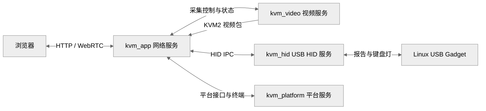

# 理解 Go 服务和网页的系统职责

这一课不写程序，目标是把运行中的系统分清楚：浏览器、视频、USB 键鼠和平台接口分别由谁负责，接口在哪里，出问题时该查哪一层。分不清层次，换硬件或改功能时很容易在错误的进程里找问题。

## 四个服务



图 1：四个服务的协作关系。视频流和键鼠事件走不同接口。

| 服务 | 负责什么 | 主要接口 | 不该做什么 |
| --- | --- | --- | --- |
| `kvm_app` | 网页、会话、WebRTC、输入事件解析与设置 | 浏览器走 HTTP/WebRTC；向视频、HID、平台服务发本地请求 | 不直接碰编码器，也不直接写 `/dev/hidgX` |
| `kvm_video` | V4L2 采集、缓冲区导入、硬件编码、视频控制 | 用本地 Socket 把 KVM2 视频包送给网络服务，接受启停和刷新请求 | 不负责网页登录和会话仲裁 |
| `kvm_hid` | Gadget 配置、报告写入、键盘灯、断线释放 | 接收网络服务的输入事件，写 `/dev/hidgX` | 不负责浏览器身份认证 |
| `kvm_platform` | 系统接口、终端桥接、设备身份与配置 | 由网络服务调用 | 设备能力取决于实现和配置，不能从进程名推断所有外设可用 |

视频流和键鼠事件走不同接口；板级设备访问留在对应服务里，这是换硬件时只改一层的前提。

## 进程与启动

配套系统由 `run-kvm.sh` 监督四个进程。在板上确认：

```sh
pidof kvm_app kvm_video kvm_hid kvm_platform
```

```text
9980 9984 9977 9946
```

**进程存在和视频正在采集是两种状态**：浏览器会话通过控制接口启动采集，视频进程本身可以等待命令。查看各自日志：

```sh
tail -30 /tmp/kvm-app.log
tail -30 /tmp/kvm-hid.log
```

```text
INF kvm video new client connection accepted ... socket_path=/tmp/kvm_video_stream.sock
INF kvm video native video stream connected
INF kvm video encoder H264 parameter sets ... profile-level-id=64002a
```

## 本地 Socket

同一台 Linux 主机上的进程通过 Unix Socket 通信。当前安装配置的路径：

```text
/tmp/kvm_video_stream.sock   视频数据
/var/run/kvm_ctrl.sock       采集控制
/run/kvm/hid.sock            USB HID 接口
/run/kvm/platform.sock       平台接口
```

这些路径由安装目录里的 `platform.env` 指定，例如：

```sh
grep SOCKET /userdata/100ask_kvm/platform.env
```

```text
export KVM_HID_SOCKET=/run/kvm/hid.sock
export KVM_VIDEO_CTRL_SOCKET=/var/run/kvm_ctrl.sock
export KVM_VIDEO_DATA_SOCKET=/tmp/kvm_video_stream.sock
export KVM_PLATFORM_SOCKET=/run/kvm/platform.sock
```

在板上只读检查文件和连接：

```sh
ls -l /tmp/kvm_video_stream.sock /var/run/kvm_ctrl.sock
ls -l /run/kvm/hid.sock /run/kvm/platform.sock
```

```text
srw------- /run/kvm/hid.sock
srw------- /run/kvm/platform.sock
srwxr-xr-x /tmp/kvm_video_stream.sock
srwxr-xr-x /var/run/kvm_ctrl.sock
```

**Socket 文件存在只证明路径建立过**，还要结合进程、日志和业务结果：浏览器能不能出画面、按键有没有到被控设备、终端能不能开。不要手工再起一个 HID 服务来“验证连接”，它会和现有服务争同一个 Gadget。

## 换硬件时改哪一层

| 现象 | 先查哪一层 |
| --- | --- |
| 没有 `/dev/video0` | Linux 驱动、设备树、采集模块供电 |
| 有节点但 HDMI 无画面 | 驱动、输入信号、采集格式 |
| 网页菜单正常但没有视频 | 网络服务与视频服务的 Socket、视频进程日志 |
| 视频正常但键鼠没反应 | HID 服务、Gadget 绑定、主机枚举 |
| 终端打不开 | 平台服务与 `board.json` 配置 |

网页资源被编进网络服务程序，**改前端后要重新构建并部署应用**；只把网页源码复制到板子不会改变网页。接口分离减少了跨层修改，但不代表任意板卡都能直接运行同一组程序。

## 验收

- 能说出四个服务各自的职责和一条主要接口；
- 能在板上确认四个进程、四个 Socket 和对应日志；
- 给定一个现象，能判断先查驱动、视频服务、网络服务还是 HID 服务。

下一课从视频包入手，把采集时刻和浏览器播放连起来。
