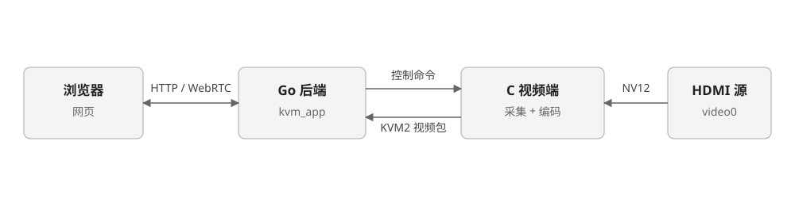

# 把 C 视频端接到 Go 后端

前面已经分别做出采集、编码和键鼠报告。这一课把第 12–17 课的采集与编码组装成一个视频服务，连接现有 Go 后端的控制和数据 Socket，让浏览器播放**你自己程序编出的画面**。不修改 Go 后端，也不用测试脚本冒充视频端。

## 程序在系统里的位置



图 1：C 视频端替代正式视频程序，接在 Go 后端前面。

| 部分 | 负责什么 | 本课是否实现 |
| --- | --- | --- |
| Go 后端 | 网页、会话、WebRTC、把控制命令发给视频端 | 使用现有程序，不改 |
| C 视频端 | V4L2 采集、VE 编码、KVM2 发送、控制命令 | 本课编写 |
| 浏览器 | 建立会话、解码显示 | 直接打开网页 |

视频端启动时连接两个 Unix Socket：

- 控制 Socket：接收 `start_video`、`stop_video`、`request_keyframe`，用 JSON 每行一条。
- 数据 Socket：发送 KVM2 视频包，20 字节包头加 Annex-B H.264。

**Go 后端在建立 WebRTC 会话前需要 SPS/PPS**。如果等到 `start_video` 才连数据 Socket，Go 会因为“parameter sets are not ready”拒绝会话，也就不会发 `start_video`，形成死锁。所以程序启动后就要连上数据 Socket，并把编码器初始化时产生的配置包发过去；之后的采集启停只影响图像帧。

## 组装程序

### 先连两个 Socket

编码器初始化会立即产生 SPS/PPS，因此顺序是：创建编码器 → 配置回调保存配置包 → 连数据 Socket 并回放配置包 → 连控制 Socket。

```cpp
g_encoder = AWVideoEncoder::create();
g_encoder->init(&param, &g_sender);

for (int i = 0; i < 60 && g_running; i++) {
    if (ensure_data_connected())
        break;
    sleep(1);
}
```

`ensure_data_connected()` 连接成功后，如果已经有配置包，就按 KVM2 配置包再发一次：

```cpp
if (!g_codec_header.empty())
    send_packet_locked(g_codec_header.data(), g_codec_header.size(), nullptr, 0, 0, true);
g_force_idr = true;
```

视频发送失败时关闭数据连接，下一帧再重连；重连后回放配置包并强制 IDR，避免继续发失去参考的 P 帧。

### 采集与编码沿用前面的实验

采集部分仍是第 13–14 课的 V4L2 多平面接口：`S_FMT` 设 NV12，`S_PARM` 设 1080p60，`REQBUFS`/`QUERYBUF`/`mmap`，每个缓冲区通过 `VIDIOC_EXPBUF` 和 `/dev/cedar_dev` 的 ioctl 导入 VE。编码器仍是第 15–17 课的 `AWVideoEncoder`，参数为 H.264、VBR、12 Mbps、最大关键帧间隔 60。

本课新增的是把每帧交给编码器的方式：

```cpp
packet.pAddrPhy0 = (unsigned char *)(uintptr_t)buffers[index].phy;
packet.dataLen0 = WIDTH * HEIGHT;
packet.pAddrPhy1 = (unsigned char *)(uintptr_t)(buffers[index].phy + WIDTH * HEIGHT);
packet.dataLen1 = WIDTH * HEIGHT / 2;
packet.pts = (int64_t)(g_capture_us / 1000);
packet.isKeyframe = g_force_idr.exchange(false);
```

`isKeyframe = true` 会让编码器在下一帧输出 IDR。开始采集、收到 `request_keyframe`、数据连接重连时都把 `g_force_idr` 置位。

编码器只创建一次，`start_video`/`stop_video` 只重建采集会话，不反复销毁编码器。这样停止再开始时不会重新初始化 VE，也保留配置包。

### 编码结果发成 KVM2

编码回调是同步的，输出指针只在回调期间有效，所以必须在回调里发送完。包头字段：

| 偏移 | 字节 | 内容 |
| --- | --- | --- |
| 0 | 4 | `KVM2` |
| 4 | 4 | 负载长度，小端 |
| 8 | 8 | 采集单调时间，微秒；配置包为 0 |
| 16 | 4 | flags，bit 0 为配置包 |
| 20 | 长度 | Annex-B H.264 |

```cpp
memcpy(header, "KVM2", 4);
uint32_t length = an + bn;
uint64_t timestamp = config ? 0 : capture_us;
uint32_t flags = config ? 1 : 0;
memcpy(header + 4, &length, 4);
memcpy(header + 8, &timestamp, 8);
memcpy(header + 16, &flags, 4);
```

发送给数据 Socket 设置 100 ms 发送超时。包头和负载必须整条写完；超时或短写就关闭连接、置 `g_force_idr`，下一次从配置包和 IDR 重新开始。**不能在半包连接上继续发下一帧**。

### 接收控制命令

控制线程按行读取 JSON，只解析需要的字段：

```cpp
if (action == "start_video") {
    g_active = true;
    g_force_idr = true;
} else if (action == "stop_video") {
    g_active = false;
} else if (action == "request_keyframe") {
    g_force_idr = true;
}
```

Go 端有些请求带 `seq`（例如 `set_edid`），会在另一个线程里等待响应。本课不实现 EDID，收到带 `seq` 的未知命令时回一行错误，避免 Go 端等满 5 秒：

```json
{"seq":3,"error":"unsupported action"}
```

采集开始和停止时向控制 Socket 回 `video_input_state`，网页用它更新“无信号/正常播放”：

```json
{"event":"video_input_state","data":{"ready":true,"error":"","width":1920,"height":1080,"fps":60}}
```

`start_video` 只创建一次采集线程；重复收到时不重复启动，只按需请求关键帧。`stop_video` 后采集循环退出，关闭 V4L2 并等待约 1 秒释放设备，下一次 `start_video` 再重新初始化。

完整程序在课件 [23-video-socket/kvm_video_node.cpp](/examples/kvm/06-integration/23-video-socket/kvm_video_node.cpp)。

## 编译

在开发主机进入课件目录，用 SDK 的交叉编译器构建。SDK 路径不是 `~/T527_Tina5.0_SDK` 时传 `SDK_ROOT`：

```bash
cd <课件目录>
make SDK_ROOT=~/T527_Tina5.0_SDK
```

Makefile 会做两件事：用 SDK 自带的编码封装源码编出 `awvencoder.o`（带 Level 4.2 宏），再链接本课程序与 SDK 库。核对产物：

```bash
file kvm_video_node
~/T527_Tina5.0_SDK/out/toolchain/gcc-arm-10.3-2021.07-x86_64-aarch64-none-linux-gnu/bin/aarch64-none-linux-gnu-readelf -h kvm_video_node | grep Machine
```

应看到 `ELF 64-bit LSB executable, ARM aarch64` 和 `Machine: AArch64`。板端没有编译器，`kvm_video_node.cpp` 要在开发主机交叉编译，不能把源码拷到板子上直接 `g++`。

## 部署与运行

开发主机在课件目录起 HTTP 服务：

```bash
python3 -m http.server 8000
```

板端下载并核对：

```sh
mkdir -p /tmp/kvm23c && cd /tmp/kvm23c
wget -q -O kvm_video_node http://192.168.1.69:8000/kvm_video_node
wget -q -O run-tutorial.sh http://192.168.1.69:8000/run-tutorial.sh
chmod +x kvm_video_node run-tutorial.sh
md5sum kvm_video_node run-tutorial.sh
```

主机对两个文件执行 `md5sum`，两边应一致。

`run-tutorial.sh` 不改 `platform.env`，而是复制一份到 `/tmp/kvm-tutorial.env`，只覆盖 `KVM_VIDEO_BINARY`：

```sh
cp /userdata/100ask_kvm/platform.env /tmp/kvm-tutorial.env
printf 'export KVM_VIDEO_BINARY=%s\n' "$BIN" >> /tmp/kvm-tutorial.env
KVM_PLATFORM_PROFILE=/tmp/kvm-tutorial.env /userdata/100ask_kvm/run-kvm.sh
```

这样平台服务、HID、Go 后端和进程监督都保持原样，只有视频端换成我们的程序。脚本退出时结束监督进程并执行 `S99kvm start`，恢复生产版本。

运行：

```sh
cd /tmp/kvm23c
sh run-tutorial.sh
```

看到 `C video node started` 后，用浏览器打开 `http://<板端 IP>/`。本次样机为 `http://192.168.1.52/`。页面出现“正常播放 1920 × 1080”就说明 Go 后端已经收到你的视频。

板端日志：

```text
[18156874] video node start ctrl=/var/run/kvm_ctrl.sock data=/tmp/kvm_video_stream.sock
[18156875] waiting for data socket /tmp/kvm_video_stream.sock: Connection refused
[18156920] encoder config packet 24 bytes
[18156920] data socket connected: /tmp/kvm_video_stream.sock
[18156921] ctrl socket connected: /var/run/kvm_ctrl.sock
[18397497] ctrl command: request_keyframe
[18397497] keyframe requested
[18397497] ctrl command: start_video
[18397497] start capture requested
[18397557] waiting for HDMI lock
[18397771] capture started 1920x1080@60
[18399771] capture fps=59.5 sent=119 encoded=119
[18401771] capture fps=60.0 sent=239 encoded=239
```

启动时 `Connection refused` 是 Go 后端还没开始监听，重试后连上；配置包 24 字节就是 SPS/PPS。浏览器打开后 Go 先请求关键帧，再发 `start_video`；第一帧 IDR 由 `g_force_idr` 触发。

Go 后端日志能看到对应记录：

```text
INF kvm video native video stream connected
INF kvm video encoder H264 parameter sets fmtp=...profile-level-id=64002a
INF kvm video requested video keyframe reason=ice-connected
INF kvm video video capture timestamp received capture_us=18397795969 idr=true
INF kvm video video capture timestamp received capture_us=18397812666 idr=false
```

关闭页面，Go 发 `stop_video`，板端日志出现 `stop capture requested` 和 `capture stopped`；重新打开页面，Go 再次请求关键帧并发 `start_video`，采集重新开始。

验证完按 `Ctrl-C`：脚本结束监督进程，执行 `S99kvm start`。确认生产状态：

```sh
pidof kvm_app kvm_video kvm_hid kvm_platform
cat /sys/class/udc/4100000.udc-controller/state
```

四个进程都在、UDC 为 `configured`，浏览器应恢复正式版本画面。

## 常见问题

| 现象 | 原因与处理 |
| --- | --- |
| 网页报 `video encoder parameter sets are not ready` | 数据 Socket 没在启动时连上，Go 拿不到 SPS/PPS，也不会发 `start_video`。先连数据通道再等命令 |
| 有 `start_video` 但日志停在 `waiting for HDMI lock` | HDMI 源没输出或没锁定。检查被控设备输出和线缆 |
| `VIDIOC_S_FMT`/`STREAMON` 失败 | `/dev/video0` 被另一个采集者占用。确认生产视频进程已停，别同时跑两份 |
| `data socket connected` 后立刻断开 | Go 后端退出或 Socket 路径不一致。检查 `platform.env` 和 `/tmp/kvm_video_stream.sock` |
| 页面一直等待第一帧 | 先看 Go 日志有没有 `parameter sets` 和 `capture timestamp`，再看板端日志有没有 `sent=` 增长 |
| 出现 `unsupported action` | Go 请求了本课没实现的 `set_edid` 等动作。只影响对应功能，视频仍可播放 |
| 停止后立刻开始失败 | V4L2 释放需要约 1 秒；采集循环退出后等设备释放再重新初始化 |

本课固定 1920×1080@60、NV12、单数据客户端，不实现 HDMI 热插拔、动态分辨率、EDID 和多客户端会话。这些属于后续验收边界，不能因为程序能出画面就认为全部支持。

## 验收

- 用 `make` 得到 AArch64 的 `kvm_video_node`，板端 MD5 与主机一致。
- 打开网页后 Go 日志出现 `parameter sets` 和 `idr=true` 的采集时间，板端 `sent=` 持续增长。
- 网页显示 `1920 × 1080` 并能看到 HDMI 源画面；关闭页面后采集停止，重新打开能恢复。
- 按 `Ctrl-C` 后生产 KVM 服务恢复、UDC `configured`，浏览器回到正式版本。

下一课用同样的方法把键鼠接到 Go 后端：C 程序实现 HID IPC 服务，替换正式 HID 服务，让网页键盘鼠标真正送到被控设备。
