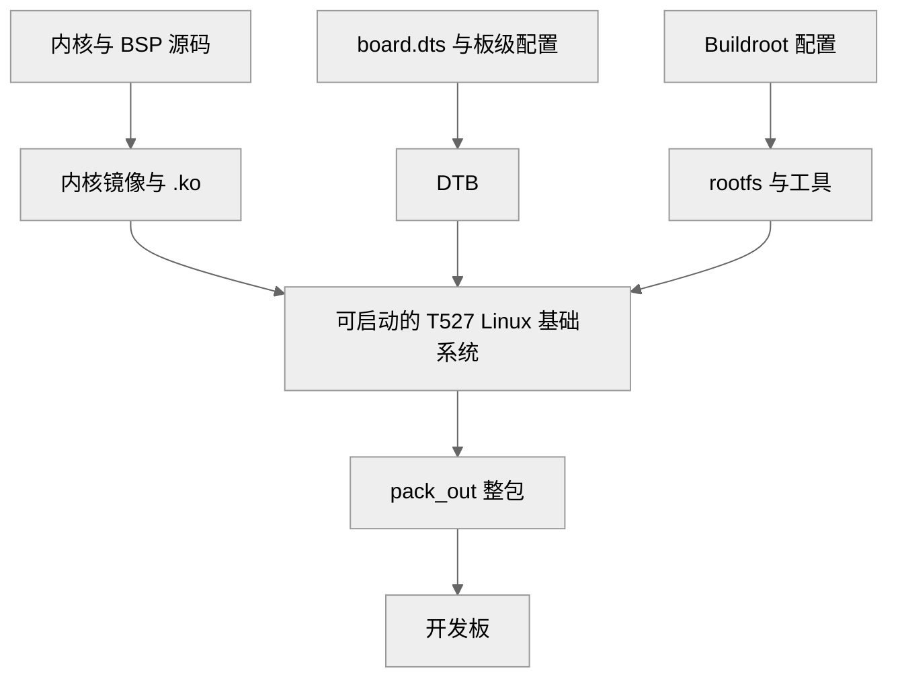

# 准备主机、SDK 和调试环境

串口、WiFi 和文件传输准备好后，就可以开始准备开发环境。串口登录和网络配置见[连接 WiFi 与确认网络](./wifi-network.md)。

这一课准备开发主机和板端两个环境：在 Ubuntu 开发主机里恢复或找到 SDK，确认交叉编译器能生成 T527 使用的 ARM64 程序；在开发板上打通终端，能执行后续的查看和运行命令。后续课程中的“开发主机”和“板端”分别指下面两个环境：

| 环境 | 在这里做什么 | 本课如何确认 |
| --- | --- | --- |
| Ubuntu 开发主机 | 查看和修改源码、编译程序、检查生成文件 | 找到 SDK，完成一次最小编译 |
| T527 开发板（板端） | 运行采集、编码和键鼠服务，查看设备与日志 | 通过终端读取内核版本和设备型号 |

## Ubuntu 24.04 开发主机的依赖

课程不提供开发主机或虚拟机镜像；开发主机可以是自己的 Ubuntu 24.04 物理机、虚拟机或 WSL。下面以 Ubuntu 24.04 为例，先安装 SDK 构建和交叉编译需要的主机工具。只运行预编译镜像不需要这些包；要解压 SDK、编译内核/驱动或课件程序时再装。

```bash
sudo apt update
sudo apt install -y \
  build-essential git bc bison flex libssl-dev libncurses-dev \
  libelf-dev libfdt-dev libyaml-dev libudev-dev zlib1g-dev dwarves \
  python3 python3-dev python3-pip python3-setuptools python3-venv python-is-python3 \
  swig pkg-config gettext autoconf automake libtool libtool-bin \
  texinfo help2man rsync cpio unzip zip file wget curl \
  device-tree-compiler u-boot-tools dosfstools mtools e2fsprogs \
  fakeroot kmod gawk patch perl bzip2 xz-utils zstd lz4 locales
sudo locale-gen en_US.UTF-8
```

这些是 Tina/Buildroot 构建常用的主机工具。SDK 自带 GCC 10.3 的 AArch64 交叉编译器，**不要用 apt 安装的 `gcc-aarch64-linux-gnu` 替代它**；交叉编译器在解压后的 SDK `out/toolchain/` 下。

只构建内核、DTB 和 rootfs 不需要 Go。要重新编译 Go 后端时，SDK 的 `kvm/go.mod` 要求 Go 1.23.4，而 Ubuntu 24.04 apt 默认是 1.22，需要单独安装：

```bash
cd /tmp
wget https://go.dev/dl/go1.23.4.linux-amd64.tar.gz
sudo rm -rf /usr/local/go
sudo tar -C /usr/local -xzf go1.23.4.linux-amd64.tar.gz
echo 'export PATH=/usr/local/go/bin:$PATH' >> ~/.profile
source ~/.profile
go version
```

最后一条应输出 `go version go1.23.4 linux/amd64`。Go 模块首次编译还需要联网下载依赖。

## 如果 SDK 是分卷归档

配套 SDK 也可能以分卷 tar.gz 的形式交付：`T527_Tina5.0_SDK.tar.gz.00`、`.01`……以及 `SHA256SUMS`。本次归档共 6 卷，压缩后约 21G，解压后约 39G。**不要只解压其中一卷**，也不要在 Windows 上直接双击 `.00`；这些卷必须按 00、01、02 的顺序拼成一条 tar.gz 流再解压。

这是开发用的 SDK 源码树，不是可直接烧录的整机镜像；只需要运行参考系统的读者看[运行参考镜像](./reference-image.md)。

### 放到同一目录并确认空间

把 6 个卷和 `SHA256SUMS` 放到 Ubuntu 开发主机的同一个目录，例如 `~/sdk-archive`。从 Windows 下载后，用共享目录、`scp` 或移动硬盘传到开发主机；不要在 Windows 里解压后再拷，符号链接和权限会丢失。

```bash
mkdir -p ~/sdk-archive
cd ~/sdk-archive
ls -lh
df -h ~
```

`ls` 应看到 `.00` 到 `.05` 六个卷和 `SHA256SUMS`；`df` 的可用空间至少要有 60G（分卷 21G + 解压 39G）；要整包构建建议留 100G 以上。卷的大小正好是 4GiB，FAT32 U 盘放不下单个文件；用 exFAT/NTFS 盘、共享目录或网络传输。

### 校验分卷

```bash
cd ~/sdk-archive
sha256sum -c SHA256SUMS
```

每个卷都应输出 `OK`。任何一卷 `FAILED` 都说明下载不完整或文件损坏，重新下载那一卷，不要继续解压。卷名也不能改，`SHA256SUMS` 按原文件名校验。

### 合并并解压

确认主目录没有旧的 `T527_Tina5.0_SDK`；有的话先改名或删除，避免新旧文件混在一起。然后在主目录执行：

```bash
cd ~
cat ~/sdk-archive/T527_Tina5.0_SDK.tar.gz.* | tar -xzf -
```

这里没有先合并成 21G 的大文件，而是边读边解压，省一份临时空间。`cat` 的通配符会按 `.00`、`.01`……的顺序读取所有卷；不要漏卷，也不要改卷名。

解压时可能看到：

```text
tar: T527_Tina5.0_SDK/out/serversocket: socket ignored
```

这是正常的：Unix Socket 不能被 tar 保存，运行时会重新创建，不影响源码、工具链和构建产物。

### 检查恢复结果

```bash
cd ~/T527_Tina5.0_SDK
du -sh .
ls .buildconfig build.sh device buildroot out
```

应看到约 39G 的 SDK，以及构建入口、板级配置和工具链目录。若空间紧张，确认解压完整后可以删除 `~/sdk-archive` 里的分卷，保留 `SHA256SUMS` 作为记录；在此之前不要删。

| 现象 | 处理 |
| --- | --- |
| `sha256sum` 某卷 `FAILED` | 重新下载该卷，保持文件名不变 |
| `tar: Unexpected EOF` 或 `not in gzip format` | 卷缺失、顺序错或文件损坏；核对 `.00` 到最后一卷，删掉不完整的 `~/T527_Tina5.0_SDK` 后重试 |
| `No space left on device` | 可用空间不足 60G；清理或换更大磁盘，解压成功前不要删分卷 |
| `Permission denied` | 用 `ubuntu` 用户解压，不要 `sudo`；已经用 root 解压时执行 `sudo chown -R "$USER:$USER" ~/T527_Tina5.0_SDK` |
| 只有 Windows，想直接解压 | 不要用解压软件逐个打开 `.00`；用 WSL 或自己的 Ubuntu 虚拟机按上面命令合并，或在 Windows 用 `copy /b` 合并后再在 Linux 里解压 |

已经解压过 SDK 的读者可以跳过本节，直接进入下一节设置路径。

## 进入 SDK 并设置路径

登录 Ubuntu 开发主机后，可以直接打开主机终端，也可以从电脑上的终端通过 SSH 登录。SSH 命令格式为 `ssh <用户名>@主机IP`，执行时替换成实际用户名和地址。

登录后，在 **Ubuntu 开发主机的终端**执行：

```bash
cd ~/T527_Tina5.0_SDK
export SDK_ROOT="$PWD"
pwd
uname -m
```

SDK 解压后通常位于当前用户的主目录，`pwd` 应显示以 `T527_Tina5.0_SDK` 结尾的路径，`uname -m` 输出 `x86_64`。如果 SDK 存放在其他目录，先进入实际目录，再设置 `SDK_ROOT`；后续命令通过这个变量定位源码和工具链。

`SDK_ROOT` 只在当前终端会话中生效。重新打开终端后，需要再次进入 SDK 并设置它。

## 找到后续要修改的源码

SDK 不只有应用程序，还包含板级配置、内核驱动和构建工具。后续课程会用到以下文件，路径均相对 SDK 根目录：

| 路径 | 后续用途 |
| --- | --- |
| `.buildconfig` | 查看当前选择的板型、内核架构和工具链 |
| `device/config/chips/t527/configs/demo_linux_aiot/linux-5.15/board.dts` | 描述本板的采集接口、I²C 和 GPIO 配置 |
| `bsp/drivers/vin/modules/sensor/lt6911c_mipi.c` | HDMI 采集模块的驱动 |

在 SDK 根目录读取当前构建配置：

```bash
cd "$SDK_ROOT"
grep -E 'LICHEE_BOARD=|LICHEE_KERNEL_ARCH=|LICHEE_KERNEL_VERSION=|LICHEE_BR_VER=' .buildconfig
ls bsp/drivers/vin/modules/sensor/lt6911c_mipi.c
```

配套 SDK 的配置输出为：

```text
export LICHEE_BOARD=demo_linux_aiot
export LICHEE_KERNEL_ARCH=arm64
export LICHEE_KERNEL_VERSION=5.15.147
export LICHEE_BR_VER=202205
```

其中 `demo_linux_aiot` 是 SDK 使用的板级配置名，`arm64` 是生成内核的目标架构，后两项分别对应 Linux 内核版本和 Buildroot 版本。Buildroot 用来构建板端的根文件系统，板上程序需要的系统库也来自这套环境。

如果文件不存在，先检查当前目录和配套 SDK 是否完整。如果配置值不同，需核对所用 SDK 与课程的板型、版本是否一致，再继续使用后续章节的路径。

## 确认交叉编译器的目标架构

开发主机使用 x86_64 处理器环境，T527 板使用 ARM64。要在开发主机上生成板上运行的程序，需要使用 SDK 配套的**交叉编译器**：编译器本身运行在开发主机上，生成的程序面向 T527。

在同一个终端设置工具链前缀：

```bash
export CROSS_COMPILE="$SDK_ROOT/out/toolchain/gcc-arm-10.3-2021.07-x86_64-aarch64-none-linux-gnu/bin/aarch64-none-linux-gnu-"
"${CROSS_COMPILE}gcc" --version
"${CROSS_COMPILE}gcc" -dumpmachine
```

配套编译器的版本为 **GCC 10.3.1**，第二条命令输出：

```text
aarch64-none-linux-gnu
```

`aarch64` 表示编译目标是 ARM64。`CROSS_COMPILE` 是工具路径的公共前缀，加上 `gcc`、`g++` 或 `readelf`，分别得到 C 编译器、C++ 编译器和可执行文件检查工具的完整路径。这里显式指定编译器，避免误用开发主机自身的 `gcc`。

注意，设置这个变量不会自动改写别人的 Makefile；后面课程自己写的 Makefile 里显式引用 `CROSS_COMPILE` 即可。

## 编译一个最小程序

版本命令只能确认编译器能够启动。再编译一个只输出一行文字的 C 程序，可以检查编译、链接和目标文件生成是否正常，不涉及视频库或硬件驱动。

在同一个终端创建临时练习目录，写入 `hello.c`：

```bash
CHECK_DIR=$(mktemp -d /tmp/kvm-toolchain-check.XXXXXX)
cat > "$CHECK_DIR/hello.c" <<'EOF'
#include <stdio.h>

int main(void)
{
    puts("Hello, T527!");
    return 0;
}
EOF

"${CROSS_COMPILE}gcc" -Wall -Wextra -o "$CHECK_DIR/hello" "$CHECK_DIR/hello.c"
file "$CHECK_DIR/hello"
"${CROSS_COMPILE}readelf" -h "$CHECK_DIR/hello" | grep -E 'Class:|Machine:'
```

编译成功后，`file` 输出中应包含 `ELF 64-bit` 和 `ARM aarch64`，`readelf` 的关键输出为：

```text
Class:                             ELF64
Machine:                           AArch64
```

这说明已经生成 ARM64 可执行文件。此处只在开发主机上检查文件；运行目标是 T527 板，后续部署时还需确认板端的动态加载器和库与程序匹配。

### 查看程序依赖的运行库

交叉编译完成后，程序可能还需要板端提供共享库。用刚才编出来的最小程序看一下它需要什么：

```bash
file "$CHECK_DIR/hello"
"${CROSS_COMPILE}readelf" -l "$CHECK_DIR/hello" | grep 'Requesting program interpreter'
"${CROSS_COMPILE}readelf" -d "$CHECK_DIR/hello" | grep NEEDED
```

| 检查结果 | 与板端的关系 |
| --- | --- |
| `ARM aarch64` | 程序的目标架构应与 T527 一致 |
| `/lib/ld-linux-aarch64.so.1` | 程序启动时使用的动态加载器，板端必须提供 |
| `NEEDED` 列表 | 程序依赖的共享库，需要由板端系统提供 |

最小程序的 `NEEDED` 一般只有 C 库；后面链接编码库的程序还会列出 `libvencoder.so`、`libsdk_memory.so` 等，那些库由配套镜像提供。

因此，部署程序时要同时核对板端系统与编译环境的配套关系。最小程序编译通过只能说明工具链可用，不能证明后续程序的依赖库和硬件运行条件已经齐全。

## 编译 SDK 和课件程序

主机依赖、SDK 和工具链都确认后，可以按需要编译。只运行预编译镜像的读者可以跳过整包编译；要修改内核、驱动或重新打包时再执行。

### 编译 SDK

在 SDK 根目录加载环境，再执行完整编译。`source` 不能写成 `sh` 或 `./`，否则当前终端不会得到 SDK 的环境变量：

```bash
cd ~/T527_Tina5.0_SDK
source build/envsetup.sh
./build.sh
```

`./build.sh` 默认一次编译 bootloader、内核、BSP 驱动、DTB 和 rootfs，不需要再分别执行 `kernel`、`dtb`。要生成可烧录的整包时，在同一个终端执行：

```bash
./build.sh pack
```

构建过程对应下面的关系：



图 1：SDK 构建产物与板端系统的关系。

首次构建时间较长，构建期间不要同时在同一个 SDK 目录启动另一份编译。

构建后核对产物：

```bash
find out/t527/demo_linux_aiot -maxdepth 2 \
  \( -name '*.dtb' -o -name '*.ko' -o -name 'rootfs.*' -o -name 'boot.img' \) -print
ls -lh out/t527/demo_linux_aiot/pack_out | head
```

整包文件在 `out/t527/demo_linux_aiot/pack_out/` 下。文件存在不代表本次构建成功，还要看 `./build.sh` 的退出状态和时间戳；版本核对见[检查 SDK 与镜像](../drivers/sdk-build.md)；需要重新烧录时按[部署与开机启动](../deployment/startup.md)处理。

### 编译课件程序

课件和 SDK 分开维护：课件源码来自文档站或课件目录，不放进 SDK。后续课件的 Makefile 都用 `SDK_ROOT` 定位工具链，进入对应课件目录执行即可：

```bash
cd <第 23 课课件目录>
make SDK_ROOT=~/T527_Tina5.0_SDK
file kvm_video_node

cd <第 24 课课件目录>
make SDK_ROOT=~/T527_Tina5.0_SDK
file kvm_hid_service
```

两个产物都应是 `ELF 64-bit LSB executable, ARM aarch64`。板端没有编译器，程序要在开发主机上交叉编译后再传过去；完整编译、传输和运行步骤分别见[接入视频 Socket](../integration/video-socket.md)和[控制采集与远程操作](../integration/capture-control.md)。

## 打开板端终端并记录系统版本

源码与编译器检查完成后，再打开一个连接 **T527 开发板**的终端。可以使用配套串口终端，或通过板端已启用的 SSH、网页终端进入系统。网络登录使用开发板的地址；前面登录开发主机的连接仍用于源码和编译操作。

串口的接口、电平和波特率按板卡说明设置。串口连接不依赖板端网络，后续网络服务无法访问时，仍可通过它查看启动日志。

在**板端终端**执行以下只读命令：

```sh
uname -r
uname -m
cat /proc/device-tree/model
```

将输出保存为当前板端系统的记录，重点核对内核版本和架构。配套样机此前记录为 Linux `5.15.147`、`aarch64`；以手中开发板的实际输出为准。如果版本不同，下一课检查参考系统时要一并核对，避免直接混用内核模块或应用库。

板端使用 Buildroot 构建的精简系统，开发工具主要放在 Ubuntu 开发主机中。后续章节需要安装主机工具时，在开发主机执行；板端是否提供某条命令，应以实际系统为准。

完成本课后，应能找到 SDK 源码并生成一个 ARM64 可执行文件。接下来进入[传输与校验文件](./file-transfer.md)，把编译出的程序送到板端并确认能运行。
